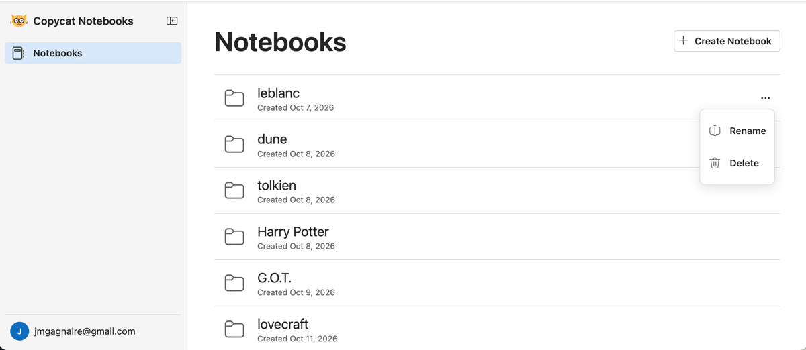
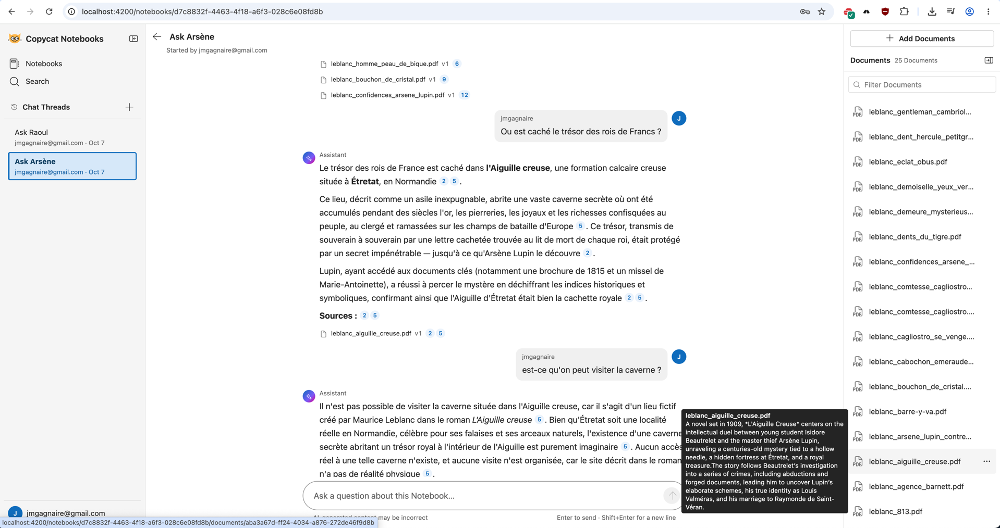

# copycat-backend

The Python backend of **Copycat Notebooks**, a clone of Copilot Notebooks.

A notebook is basically a [RAG](https://www.promptingguide.ai/research/rag) instance.<br>
You add documents, they are indexed, summarized and used to ground one or several conversation chatbot(s).<br>
The chat messages include citations, making it easier to check the answers.<br>
You could also search messages and documents by keyword (not implemented yet).<br>




<br>

This repository is the **backend only**.<br>
It serves the same HTTP contract as the original Node
backend, so the existing Angular frontend runs against it unchanged.


## Features

| Area | What you can do |
| --- | --- |
| **Notebooks** | Create, rename, delete and restore a Notebook. A Notebook groups Documents and chats. |
| **Documents** | Upload PDF, Office, Markdown or text files. Every upload is kept as a version. Download, delete, restore. |
| **Ingestion** | Each upload goes through the three-stage pipeline below, with its status live in the UI. |
| **Chat** | Ask a question in a Chat Thread. The answer streams paragraph by paragraph and cites its sources. |
| **Citations** | Every `[n]` marker in an answer is pinned to the Document version and passage it came from. |
| **Live events** | One Server-Sent Events stream per browser carries ingestion progress and answer paragraphs. |
| **Users** | Register, log in with a cookie session. Administrators, listed by email, can restore deleted Chat Threads. |
| **Search** | Both search routes exist and answer an empty result. Full-text search was left out on purpose. |

### The ingestion pipeline

| Stage | Status | What happens |
| --- | --- | --- |
| 1. Convert | `converting` | [Docling](https://github.com/docling-project/docling), in a Docker container, turns the file into Markdown. |
| 2. Summarise | `summarizing` | A language model extracts the metadata and writes an Abstract, an Executive Summary and a Chat Snippet. |
| 3. Index | `indexing` | The Markdown is split into chunks, each chunk is embedded, and the vectors are stored in Postgres. |

A Document is `ready` when all three stages are done. <br>
Stages 2 and 3 need an OpenRouter key;<br>
without one, Documents stop at `converted`.


## Architecture

```text
Angular frontend (NOTEBOOKS)  ──HTTP + SSE──▶  FastAPI app (this repo, port 3000)
                                                 │
                        ┌────────────────────────┼─────────────────────────┐
                        ▼                        ▼                         ▼
              Postgres + pgvector            MinIO (S3)              OpenRouter
         data, job queue, LISTEN/NOTIFY    raw document bytes    chat and embedding models
                        ▲
                        │ Docling container, one per conversion
                      Docker
```

- **FastAPI** with async SQLAlchemy and asyncpg. Routes are grouped by domain under `src/`.
- **Procrastinate** runs the three ingestion jobs on Postgres, in the same process as the API.
- **Postgres `LISTEN`/`NOTIFY`** carries application events from any transaction to the SSE
  stream, so a status change is only announced once it is committed.
- **pgvector** stores the embeddings; retrieval is an exact cosine-distance scan.

[Click here](docs/plan/document-lifecycle.svg) to see an overview of the document lifecycle.<br>

A fuller picture, with the routers, the job queues and the three ingestion stages, is in the
[architecture overview diagram](docs/plan/system-overview.svg).

## Getting started

### Prerequisites

- Python 3.12 and [uv](https://docs.astral.sh/uv/)
- Docker (for Postgres, MinIO and the Docling converter)
- The `NOTEBOOKS` repository next to this one: it owns the database schema and the frontend
- An [OpenRouter](https://openrouter.ai) API key, for summaries, embeddings and chat. Without it
  the server still runs: Documents stop at `converted` and asking a question answers 503.

### 1. Start the infrastructure and apply the schema

The database schema is owned by the Node backend and applied from the `NOTEBOOKS` repository:

```sh
cd ../../NOTEBOOKS
docker compose up -d          # Postgres with pgvector, MinIO
pnpm install && pnpm backend:migrate
```

The Docling image is pulled by Docker the first time a Document is converted.

### 2. Configure

```sh
cd ../BACKEND/copycat-backend
cp .env.example .env          # then set OPENROUTER_API_KEY and ADMIN_EMAILS
uv sync
```

### 3. Create the job-queue tables

Once per database:

```sh
cd src && PYTHONPATH=. uv run procrastinate --app jobs.app.job_app schema --apply && cd ..
```

### 4. Run

```sh
uv run python main.py         # listens on http://localhost:3000, no autoreload
```

The interactive API documentation is at <http://localhost:3000/swagger>.

To use the UI, start the frontend from the `NOTEBOOKS` repository and open
<http://localhost:4200>:

```sh
cd ../../NOTEBOOKS
pnpm frontend:dev
```

### 5. Test

The tests run against the same Postgres; every test runs in a transaction that is rolled back,
so nothing is left behind. Set `TEST_DATABASE_URL` to use a separate database.

```sh
uv run pytest -q
```

## Configuration

All settings come from `.env` (see `.env.example`) or the environment.

| Variable | Purpose |
| --- | --- |
| `DATABASE_URL` | Postgres DSN, `postgresql+asyncpg://...` |
| `ADMIN_EMAILS` | comma-separated emails allowed to restore deleted Chat Threads |
| `OPENROUTER_API_KEY` | enables ingestion stages 2 and 3 and the chat; empty disables them |
| `OPENROUTER_MODEL_*` | which model runs each task: metadata, the three summaries, chat answers, embeddings |
| `DOCLING_TABLE_MODE` | Docling's table extraction mode, `fast` or `accurate` |
| `MINIO_ENDPOINT`, `MINIO_ACCESS_KEY`, `MINIO_SECRET_KEY`, `DOCUMENTS_BUCKET` | where raw files are stored |
| `PORT`, `LOG_LEVEL` | server port (the frontend expects 3000) and logging level |

## Project layout

```text
main.py              starts uvicorn on src/app/main.py
src/
  app/               FastAPI app, lifespan (storage, job worker, event listener, chat deps)
  auth/              register, login, session cookie, current-user guard
  notebook/          Notebooks CRUD
  document/          Documents, versions, upload and download, chunk ranges
  ingestion/         the three pipeline stages, Docling driver, chunking, summaries
  jobs/              the Procrastinate app, tasks and worker
  llm/               OpenRouter chat and embedding clients, model configuration
  chat/              Chat Threads, retrieval, citations, streaming answers
  event/             application events over LISTEN/NOTIFY and the SSE route
  search/            the two search routes (stubbed)
  storage/           MinIO through the S3 API
test/                pytest suite, one file per module
docs/plan/           the development plan and one file per task
```

## Development

```sh
uv run ruff check src test --fix && uv run ruff format src test   # lint and format
uv run pyright                                                    # type check, strict on unknowns
uvx pyrefly check                                                 # second type checker, run by pre-commit
uv run pre-commit install                                         # hooks on every commit
```

Commit messages must start with a ticket reference such as `NBK-123:`; the commit-msg hook
checks it.

### Deliberate simplifications

Compared with the Node backend, this port leaves out, by decision:

- retrying a failed ingestion (re-uploading the file is the retry);
- per-section summaries and the corrective rewrite of long summaries: a document longer than the
  model's budget is truncated, not mapped and reduced;
- keyword search over Documents and Chat Threads (both routes answer an empty result);
- failure reasons from the language model are recorded as `unexpected`.

## Educational purpose

This project exists to learn Python / validate Python skills. The method: rebuild a real
application whose behaviour, API contract and tests already exist.

The work is split into twenty tasks. Each task file has four parts:

1. a short tutorial of what you need to know, with runnable examples;
2. what to build, step by step;
3. a "DONE WHEN" check for each step;
4. references to the original Node code.

Where to look:

| Where | What you find |
| --- | --- |
| [docs/plan/README.md](docs/plan/README.md) | The plan, the task table, the estimates, and what was cut to fit the time. |
| [docs/plan/tasks/](docs/plan/tasks/) | One file per task, listed below. |
| [system-overview.svg](docs/plan/system-overview.svg), [document-lifecycle.svg](docs/plan/document-lifecycle.svg) | The two diagrams the tasks refer to. |

The tasks:

| Task | Topic |
| --- | --- |
| [T01](docs/plan/tasks/T01-foundation.md) | Project foundation: settings, database, app bootstrap |
| [T02](docs/plan/tasks/T02-entities.md) | SQLAlchemy entities matching the schema |
| [T03](docs/plan/tasks/T03-auth.md) | Authentication: register, login, session cookie |
| [T04](docs/plan/tasks/T04-notebooks.md) | Notebooks: repository and routes |
| [T05](docs/plan/tasks/T05-test-harness.md) | Test harness: rolled-back database sessions, in-process client |
| [T06](docs/plan/tasks/T06-events.md) | App events: Postgres LISTEN/NOTIFY and Server-Sent Events |
| [T07](docs/plan/tasks/T07-storage.md) | Object storage with MinIO |
| [T08](docs/plan/tasks/T08-documents.md) | Documents: upload, versions, reads, delete and restore |
| [T09](docs/plan/tasks/T09-job-queue.md) | Background job queue on Postgres with Procrastinate |
| [T10](docs/plan/tasks/T10-ingestion-stage1.md) | Ingestion stage 1: conversion to Markdown with Docling, driven from asyncio |
| [T11](docs/plan/tasks/T11-llm-clients.md) | OpenRouter clients: completion, streaming, embeddings |
| [T12](docs/plan/tasks/T12-ingestion-stage2.md) | Ingestion stage 2: metadata and the three summaries |
| [T13](docs/plan/tasks/T13-ingestion-stage3.md) | Ingestion stage 3: the recursive text splitter, embeddings and pgvector |
| [T14](docs/plan/tasks/T14-retry-ingestion.md) | Retry a failed ingestion |
| [T15](docs/plan/tasks/T15-chat-threads.md) | Chat Threads: CRUD, messages, Administrator restore |
| [T16](docs/plan/tasks/T16-chat-answers.md) | Grounded chat answers: retrieval, Citations, streaming |
| [T17](docs/plan/tasks/T17-document-search.md) | Keyword search over Documents |
| [T18](docs/plan/tasks/T18-thread-search.md) | Keyword search over Chat Threads |
| [T19](docs/plan/tasks/T19-contract-check.md) | Frontend round trip: a checklist against the real UI |
| [T20](docs/plan/tasks/T20-polish.md) | Polish: README, tooling, type checks, cleanup |

## License

[MIT](LICENSE)
