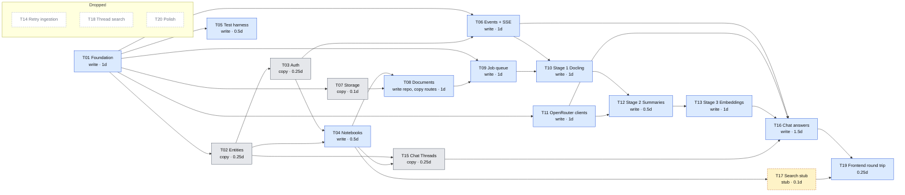
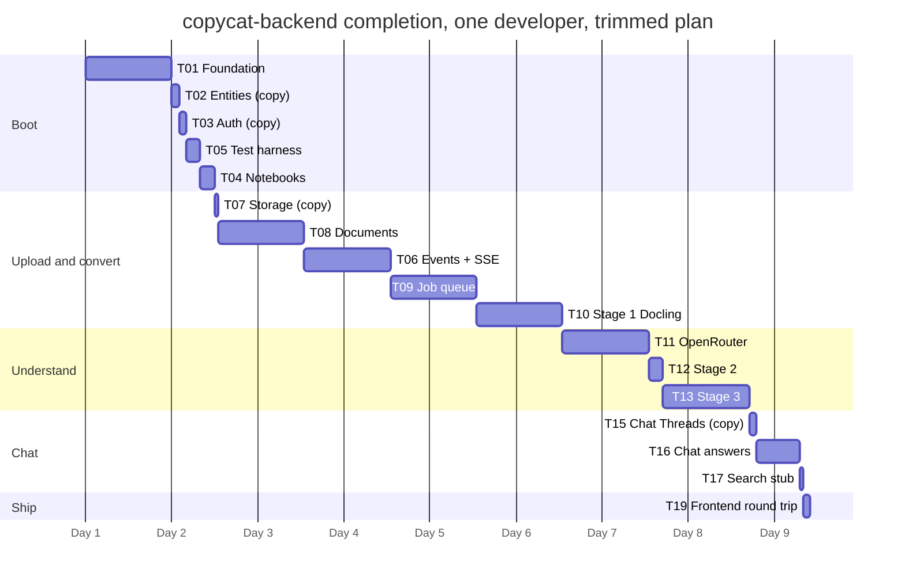

# Development plan: completing copycat-backend by hand, trimmed for time

This plan takes `BACKEND/copycat-backend` from its current state (DTOs generated from the
OpenAPI contract, entity skeletons, a working auth module, every other route a
`NotImplementedError` stub) to a backend the Angular frontend of `NOTEBOOKS` can run against.
The API contract is `NOTEBOOKS/apps/backend/openapi.json`; the behaviour to reproduce is the Node
backend in `NOTEBOOKS/apps/backend/src`; a finished Python port with the same stack sits in
`BACKEND/reference-backend` and every task points at the matching files in both.

The plan is optimised for **Python learning per hour**. Every task has a mode:

- **Write**: build it by hand. These are the tasks where the Python is (asyncio, FastAPI
  internals, SQLAlchemy, streaming HTTP, subprocesses, a job queue). Eleven tasks, about 10 days.
- **Copy**: take the files from `reference-backend`, adapt the imports, run the tests. The feature
  is needed but writing it teaches nothing new. Four tasks, about 1 day in total.
- **Stub**: one route answering an empty result so the frontend does not break. One task.
- **Drop**: not implemented at all. Four tasks. Their files stay in `tasks/` with the original
  description under "If you pick it up later".

Each task lives in `tasks/Txx-*.md` with its mode, effort, priority, dependencies, a short tutorial
of what you need to know (with runnable examples), what exists
today, what to build (or copy), acceptance criteria and references.

## How to read the estimates

- **Effort** is in ideal working days for one developer who knows Python and FastAPI but is new
  to this codebase, working without AI assistance. Add your own margin for reading the Node code.
- **Priority**: P1 is needed for the first end-to-end run (sign in, Notebooks, upload, conversion,
  live events, Thread CRUD); P2 completes the product (summaries, embeddings, chat answers).
- **Dependencies** are hard: a task's tests cannot pass before the tasks it depends on.
- **Learning** rates how much of the task is new Python ground (High, Medium, Low).

## Tasks

| Id | Task | Mode | Priority | Effort | Depends on | Learning |
| --- | --- | --- | --- | --- | --- | --- |
| T01 | [Project foundation: settings, database, app bootstrap](tasks/T01-foundation.md) | Write | P1 | 1 d | — | Medium |
| T02 | [Entities match the schema](tasks/T02-entities.md) | Copy | P1 | 0.25 d | T01 | Low |
| T03 | [Finish authentication](tasks/T03-auth.md) | Copy | P1 | 0.25 d | T01, T02 | Low |
| T04 | [Notebooks](tasks/T04-notebooks.md) | Write | P1 | 0.5 d | T02, T03 | Medium |
| T05 | [Test harness](tasks/T05-test-harness.md) | Write | P1 | 0.5 d | T01 | Medium |
| T06 | [App events bus and SSE](tasks/T06-events.md) | Write | P1 | 1 d | T01, T03 | High |
| T07 | [Object storage](tasks/T07-storage.md) | Copy | P1 | 0.1 d | T01 | Low |
| T08 | [Documents](tasks/T08-documents.md) | Write the repository, copy the routes | P1 | 1 d | T04, T07 | Medium |
| T09 | [Job queue](tasks/T09-job-queue.md) | Write | P1 | 1 d | T01, T08 | High |
| T10 | [Ingestion stage 1: Docling](tasks/T10-ingestion-stage1.md) | Write | P1 | 1 d | T06, T09 | High |
| T11 | [OpenRouter clients](tasks/T11-llm-clients.md) | Write | P1 | 1 d | T01 | Medium |
| T12 | [Ingestion stage 2: summaries](tasks/T12-ingestion-stage2.md) | Write | P2 | 0.5 d | T10, T11 | Medium |
| T13 | [Ingestion stage 3: chunks and embeddings](tasks/T13-ingestion-stage3.md) | Write | P2 | 1 d | T12 | High |
| T14 | [Retry a failed ingestion](tasks/T14-retry-ingestion.md) | Drop | — | 0 | — | — |
| T15 | [Chat Threads CRUD](tasks/T15-chat-threads.md) | Copy | P1 | 0.25 d | T02, T04 | Low |
| T16 | [Grounded chat answers](tasks/T16-chat-answers.md) | Write | P2 | 1.5 d | T06, T11, T13, T15 | High |
| T17 | [Keyword search over Documents](tasks/T17-document-search.md) | Stub (both search routes) | P2 | 0.1 d | T04 | — |
| T18 | [Keyword search over Chat Threads](tasks/T18-thread-search.md) | Drop (covered by T17's stub) | — | 0 | — | — |
| T19 | [Frontend round trip](tasks/T19-contract-check.md) | Write (a checklist) | P2 | 0.25 d | T16, T17 | Low |
| T20 | [Polish](tasks/T20-polish.md) | Drop | — | 0 | — | — |

Total: about 11 days, of which 10 are hand-written code. The critical path is
T01 → T02 → T03 → T04 → T08 → T09 → T10 → T12 → T13 → T16 → T19, about 8.5 days; T05, T06, T07,
T11 and T15 (about 3 days) fit in the gaps, mostly while Docling or a model call is running.

Before the trim the plan was about 15.5 days. What was cut and why:

- **T14 Retry** (0.5 d): a failed Version stays failed; re-uploading the file is the retry. The
  frontend's Retry button gets a 404, which it reports as an error. Accepted.
- **T17 Document search** (1.5 d): rated High, but the learning is Postgres full-text search and
  trigram SQL, not Python. Replaced by a stub answering no results.
- **T18 Thread search** (0.5 d): a repeat of T17. Covered by the same stub.
- **T19 Contract script** (0.25 d) and **T20 Polish** (0.5 d): checking and housekeeping. T19 keeps
  only the frontend round trip.
- **T02, T03, T07, T15** (2.25 d → 0.85 d) and **T08's routes** (0.5 d): copied from
  `reference-backend` instead of typed; each file says exactly what to copy and what to read once.

## Where the learning is

The tasks that teach the most are T06 (LISTEN/NOTIFY and SSE), T09 (a job queue on Postgres),
T10 (driving Docker from asyncio), T13 (the text splitter and pgvector) and T16 (retrieval,
Citations and streaming), plus T01, T04, T05 and T11 once each. Be slow and curious there. T04 is
kept as a Write task on purpose: it is the first repository and router pair, and the shape that
T08 and the copied T15 repeat.

Tests follow the same rule: build the harness in T05, then write one test per pattern (one router
test, one repository test, one job test with fakes) and stop. There is no coverage target.

## Phases

1. **Boot (T01–T05, 2.5 days).** The process starts against the database the Node backend
   migrated, serves `{"message"}` errors, signs
   users in, manages Notebooks, and has a test harness. Milestone: the frontend's login and
   Notebook list work.
2. **Upload and convert (T06–T10, 4.1 days).** Uploads are stored, enqueued, converted by Docling,
   and their status changes stream to the browser. Milestone: a PDF reaches `converted` with the
   badge updating live.
3. **Understand (T11–T13, 2.5 days).** Metadata, the three summaries, chunks and embeddings;
   Documents reach `ready`. Milestone: the Document page shows an Executive Summary.
4. **Chat (T15–T17, 1.85 days).** Threads copied, grounded streamed answers with Citations written,
   the search routes stubbed. Milestone: a question gets a streamed, cited answer.
5. **Ship (T19, 0.25 day).** Frontend round trip with a checklist.

## Dependency graph

Blue is hand-written, grey is copied from `reference-backend`, dashed amber is a stub, dashed
grey is dropped.

## Timeline (one developer)

The axis counts working days from the start of the plan.

## Working rules that keep the port honest

- No database setup in Python. The Node backend owns the schema and applies the `.sql` files in
  `NOTEBOOKS/apps/backend/src/db/migrations/`; copycat-backend neither creates, migrates nor
  checks it. The test database is prepared once by hand with the Node tooling (T05, step 2), and
  procrastinate's own job tables are applied once by hand with its CLI (T09, topic 2).
- Port the Node SQL as it is; the queries encode decisions (`docs/versioning.md`,
  `docs/search.md`) that look wrong until you read why.
- Error bodies are `{"message": "..."}` and every JSON key is camelCase; the frontend reads nothing else.
- When copying from `reference-backend`, read the file once before pasting it, fix the imports,
  and run the task's tests. Do not "improve" it; the time is for the Write tasks.
- Keep the simplifications the reference made rather than re-adding Node's accuracy: failures are
  recorded on every attempt, LLM failures are `unexpected`, summaries are one call per artifact
  over the truncated Markdown (no per-section pass, by decision), and there is no retry.
- Finish each task with its tests green before starting the next; the suite should stay under
  a minute so you keep running it.
