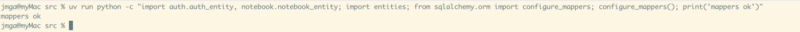
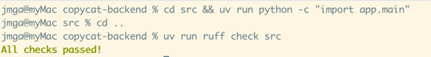
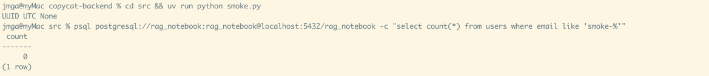

# T02 — Make the SQLAlchemy entities match the schema

| Mode | Effort | Priority | Depends on | Unblocks | Learning value |
| --- | --- | --- | --- | --- | --- |
| Copy | 0.25 day | P1 | T01 | T03, T04, T08, T15 | Low |

## Why this is a copy

The same three fixes (UUID id, server defaults, nullable timestamps) repeated over nine classes.
Nothing here is new after the first class. The reference keeps only two entities and reaches every
other table through raw SQL, which is also the design the Write tasks assume.

## Why

The entity files exist for every table but several would fail at first use (ids typed `int`, a
`Computed` on a column migration 0017 already generates, `Vector(1024)` on a `vector(2560)` column,
naive `utcnow` defaults on `timestamptz`, relationships without `back_populates`,
`KeywordEntity` with no primary key). They must describe the tables exactly as the Node
migrations created them (`docs/database-schema.md` in NOTEBOOKS).

The entities are a description, never a tool to change the database: copycat-backend never calls
`Base.metadata.create_all()` or `drop_all()`, and nothing in this task touches the schema. A
wrong entity does not break the database, it breaks the first query that uses it.

## What you need to know

### 1. `Mapped[...]` and `mapped_column`

SQLAlchemy 2 declares a column as a typed attribute. The Python type comes from the annotation;
the database type and options from `mapped_column`. `Mapped[datetime | None]` makes the column
nullable, `Mapped[datetime]` makes it NOT NULL.

```python
import uuid
from datetime import datetime
from sqlalchemy import DateTime, String, func
from sqlalchemy.dialects.postgresql import UUID
from sqlalchemy.orm import DeclarativeBase, Mapped, mapped_column


class Base(DeclarativeBase): ...


class NotebookEntity(Base):
    __tablename__ = "notebooks"
    id: Mapped[uuid.UUID] = mapped_column(
        UUID(as_uuid=True), primary_key=True, server_default=func.gen_random_uuid()
    )
    title: Mapped[str] = mapped_column(String)
    created_at: Mapped[datetime] = mapped_column(
        DateTime(timezone=True), server_default=func.now()
    )
    deleted_at: Mapped[datetime | None] = mapped_column(
        DateTime(timezone=True), nullable=True
    )
```

### 2. `server_default` versus `default`

`default=uuid.uuid4` runs in Python before the INSERT. `server_default=func.gen_random_uuid()`
tells SQLAlchemy the database fills the column, so the INSERT omits it and the value comes back
with `RETURNING` or `await db.refresh(obj)`. `server_default` sends no SQL to the database; it
only describes a default the Node migrations already created, so the entity has to declare it. The same holds for `created_at` with `func.now()`, which is
timezone-aware; `datetime.utcnow` is naive and asyncpg refuses it for `timestamptz`.

Try it: after T04's `create_notebook`, `print(notebook.id, notebook.created_at.tzinfo)` shows a
UUID and `UTC`.

### 3. `UUID(as_uuid=True)`

Without `as_uuid=True` the column reads back as a string. With it, `uuid.UUID` objects go in and
come out, which is what the route path parameters (`id: uuid.UUID`) and the DTOs expect.

### 4. Tables you never map

A table reached only with `text()` SQL needs no entity. The `chunks`, `chunk_ranges`, `citations`
and `notebook_words` tables carry a `tsvector`, a `vector(2560)` or no primary key; mapping them
costs more than it gives. The reference maps `users` and `notebooks` only.

## What to copy

1. **Copy the two entities.** `cp reference-backend/src/auth/auth_entity.py copycat-backend/src/auth/auth_entity.py`
   and the same for `notebook/notebook_entity.py`. Both import `Base` from `db.base`, which
   copycat already has. Read the four lines of the tutorial's example in each file once.

   **DONE WHEN:** the command prints `ok`:

   ```sh
   cd src && uv run python -c "import auth.auth_entity, notebook.notebook_entity; import entities; from sqlalchemy.orm import configure_mappers; configure_mappers(); print('mappers ok')"
   ```


2. **Delete the rest.** Remove `src/entities.py`, `document/document_entity.py`,
   `document/document_version_entity.py`, `document/chunk_entity.py`, `document/chunk_range_entity.py`,
   `chat/chat_thread_entity.py`, `chat/chat_message_entity.py`, `search/citation_entity.py`,
   `search/keyword_entity.py`. Then `grep -rn "entity" src --include=*.py | grep import` and fix
   each import that pointed at a deleted file (likely `src/__init__.py` files and `src/main.py`,
   which T01 deleted anyway).

   **DONE WHEN:** the first command imports without `ModuleNotFoundError` and the second reports no
   unused or unresolved imports:

   ```sh
   cd src && uv run python -c "import app.main"
   uv run ruff check src
   ```


3. **Decide the ORM question once.** Write a one-line comment at the top of `db/base.py`:
   "Only users and notebooks are mapped; every other table is read and written with `text()`."
   If you prefer the ORM for a later table, add its entity in that task with the three fixes of
   the tutorial applied.

   **DONE WHEN:**

   ✅ the comment exists and no file under `src/` imports an entity other than the two kept.


4. **Smoke test against the dev database.** Run the script below against the `rag_notebook`
   database that `.env` already points at. It inserts one user and one notebook through the ORM,
   reads them back, and deletes them again so the database is left exactly as it was. No separate
   test database is needed for this task; T05 introduces one for the pytest harness.

   ```python
   # cd src && uv run python smoke.py
   import asyncio
   from sqlalchemy import delete
   from db import AsyncSessionLocal
   from auth.auth_entity import AuthEntity
   from notebook.notebook_entity import NotebookEntity


   async def main():
       async with AsyncSessionLocal() as db:
           user = AuthEntity(email="smoke-t02@example.com", password_hash="x")
           notebook = NotebookEntity(title="Smoke T02")
           db.add_all([user, notebook])
           await db.commit()
           await db.refresh(user)
           await db.refresh(notebook)
           print(type(user.id).__name__, user.created_at.tzinfo, notebook.deleted_at)
           # remove the smoke rows so the dev database is left as it was
           await db.execute(delete(AuthEntity).where(AuthEntity.id == user.id))
           await db.execute(delete(NotebookEntity).where(NotebookEntity.id == notebook.id))
           await db.commit()


   asyncio.run(main())
   ```

   **DONE WHEN:** it prints `UUID UTC None` and
   `psql $DATABASE_URL -c "select count(*) from users where email like 'smoke-%'"` returns 0.
   Delete `smoke.py` afterwards; T05's harness replaces it.



## Acceptance

- `configure_mappers()` succeeds with the two entities imported.
- The smoke script inserts a user and a notebook through the ORM against the dev `rag_notebook`
  database, reads them back with UUID ids and timezone-aware timestamps, and cleans up after itself.

## References

- NOTEBOOKS `docs/database-schema.md`; migrations 0004, 0007, 0009, 0010, 0016–0018.
