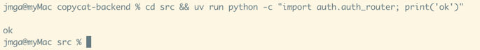
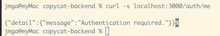
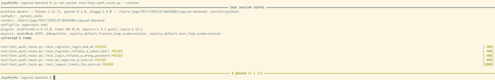

# T03 — Finish authentication

| Mode | Effort | Priority | Depends on | Unblocks | Learning value |
| --- | --- | --- | --- | --- | --- |
| Copy | 0.25 day | P1 | T01, T02 | every protected route | Low |

## Why this is a copy

The module already exists and has four runtime bugs. Fixing them teaches `IntegrityError` and
FastAPI cookie handling, nothing more. The reference module is the same ten files with the bugs
fixed; the tests are the valuable part and are kept.

## Why

Every other route depends on `CurrentUser`. The auth module as it stands answers 500 on a
duplicate email, crashes on every cookie (`int(user_id)` on a UUID), and never clears the cookie
on logout.

## What you need to know

### 1. bcrypt hashes, in a thread

`bcrypt.hashpw` is deliberately slow (about 100 ms). In an async server it must run in a worker
thread with `asyncio.to_thread`, or every other request waits.

```python
import asyncio, bcrypt


async def hash_password(password: str) -> str:
    return (
        await asyncio.to_thread(
            bcrypt.hashpw, password.encode(), bcrypt.gensalt(rounds=10)
        )
    ).decode()


async def verify_password(password: str, hashed: str) -> bool:
    return await asyncio.to_thread(bcrypt.checkpw, password.encode(), hashed.encode())
```

### 2. PyJWT session tokens

The session cookie holds a signed JWT with the user id as `sub` and an expiry. `jwt.decode`
checks the signature and the expiry and raises a `PyJWTError` subclass on any problem.

```python
import jwt
from datetime import UTC, datetime, timedelta

token = jwt.encode(
    {"sub": str(user_id), "exp": datetime.now(UTC) + timedelta(days=7)},
    settings.JWT_SECRET,
    algorithm="HS256",
)
try:
    user_id = jwt.decode(token, settings.JWT_SECRET, algorithms=["HS256"])["sub"]
except jwt.PyJWTError:
    user_id = None  # invalid, expired or signed with another secret
```

### 3. Cookies go on the response you return

`response: Response` as a route parameter gives you an object whose headers FastAPI merges into
the response it builds from your return value. That merge does not happen when you return a new
`Response` yourself, so set or delete the cookie on the object you actually return.

```python
@router.post("/logout", status_code=204)
async def logout() -> Response:
    response = Response(status_code=204)
    response.delete_cookie("session", path="/")
    return response
```

Reading a cookie is a parameter: `session: Annotated[str | None, Cookie(alias="session")] = None`.

### 4. `IntegrityError`, not `UniqueViolationError`

asyncpg raises `UniqueViolationError` for a duplicate email, but SQLAlchemy wraps every driver
error in its own `sqlalchemy.exc.IntegrityError` before it reaches your code. Catch that one and
answer 409 with a plain string detail so T01's handler produces `{"message": ...}`.

```python
from sqlalchemy.exc import IntegrityError

try:
    user = await auth_service.register_new_user(body.email, body.password)
except IntegrityError:
    raise HTTPException(409, "An account with this email already exists.") from None
```

### 5. The guard as a dependency

`get_current_user` reads the cookie, verifies the token, loads the user and raises 401 otherwise.
`CurrentUser = Annotated[AuthEntity, Depends(get_current_user)]` lets every protected route say
`user: CurrentUser` (or `_: CurrentUser` when it only needs the check).

## What to copy

1. **See the gap.** `diff -r reference-backend/src/auth copycat-backend/src/auth`. Expect four
   real differences (the defects above) and cosmetic ones.

   **DONE WHEN:** you can name which file holds each of the four defects.


2. **Copy the five files that changed.** `guard.py`, `auth_router.py`, `auth_dto.py`,
   `auth_repository.py`, `auth_service.py` from the reference over yours. The reference's
   `auth_dto.py` has one `UserResponse` (the three `*Response` DTOs were the same shape) with
   `email: EmailStr` and `created_at` serialized as `createdAt`; the router uses it for register,
   login and me. Keep your `password.py`, `auth_jwt.py` and `cookie.py` if the diff is cosmetic;
   take the reference's `auth_jwt.py` if yours does not read `JWT_SECRET` from `settings`.

   **DONE WHEN:** the command prints `ok`:

   ```sh
   cd src && uv run python -c "import auth.auth_router; print('ok')"
   ```


3. **Dependencies.** `uv add "pydantic[email]"` for `EmailStr`. Check `src/auth/__init__.py`
   still exports what `guard.py` imports (`AuthEntity`, `AuthRepository`).

   **DONE WHEN:** the server starts and the request answers `{"message":"Authentication required."}`
   with status 401:

   ```sh
   uv run python main.py
   curl -s localhost:3000/auth/me
   ```


4. **Tests, written by hand** (they need T05's `client` fixture; write them now, run them after
   T05). `test/test_auth_route.py` with five tests:

   ```python
   async def test_register_login_and_me(client):
       user = (
           await client.post(
               "/auth/register",
               json={"email": "ada@example.com", "password": "correct horse"},
           )
       ).json()
       assert "createdAt" in user
       assert (
           await client.post(
               "/auth/login",
               json={"email": "ada@example.com", "password": "correct horse"},
           )
       ).status_code == 200
       assert (await client.get("/auth/me")).json()["id"] == user["id"]
   ```

   and the same shape for: duplicate email → 409 `{"message": "An account with this email already exists."}`;
   wrong password → 401; `/auth/me` without a cookie → 401; logout (204) then `/auth/me` → 401.

   **DONE WHEN:** the suite reports 5 passed:

   ```sh
   uv run pytest test/test_auth_route.py -q
   ```



## Acceptance

- The five tests above pass. Error bodies are `{"message": "..."}`.

## References

- Node: `apps/backend/src/auth/*.ts`. Contract: `/auth/*` in `openapi.json`.
