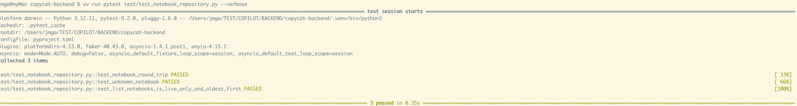
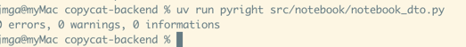
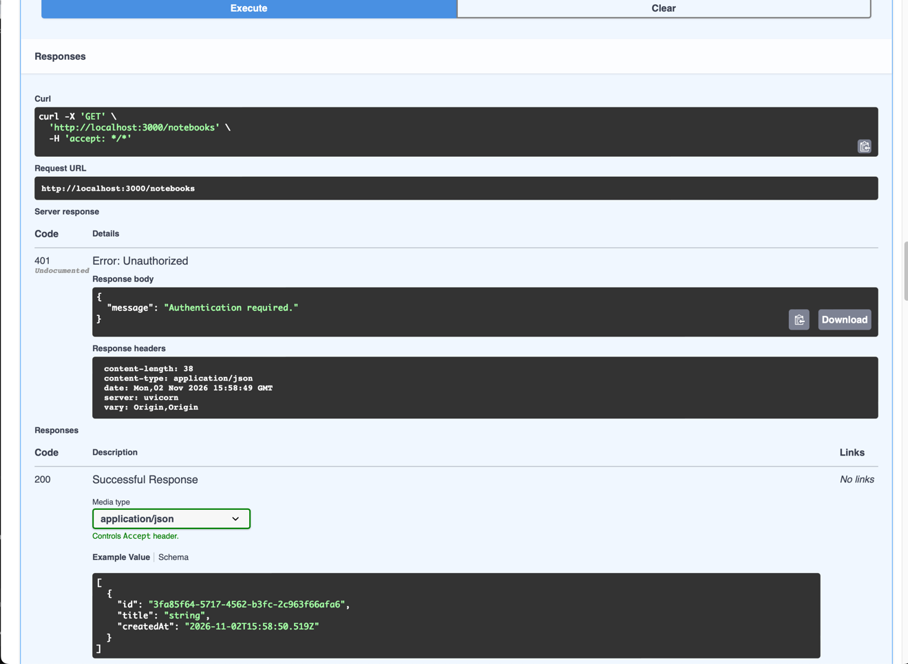
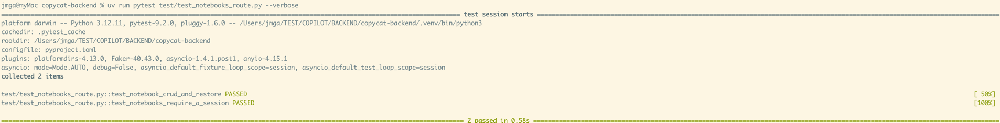
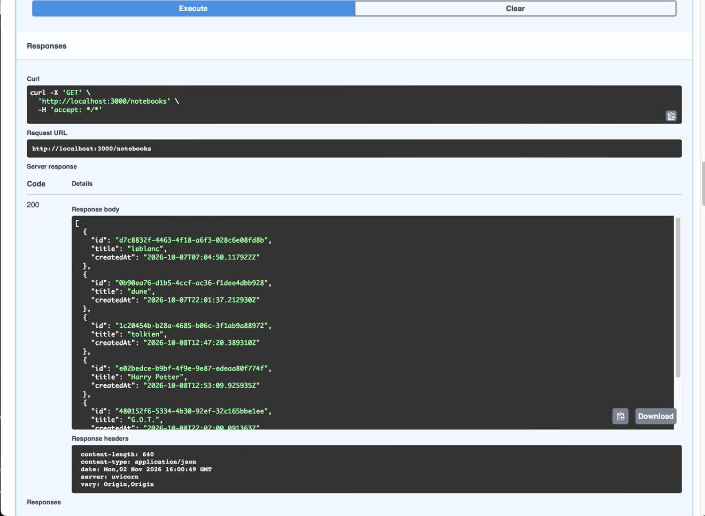

# T04 — Notebooks: repository and routes

| Mode | Effort | Priority | Depends on | Unblocks | Learning value |
| --- | --- | --- | --- | --- | --- |
| Write | 0.5 day | P1 | T02, T03 | T08, T15, T17 (stub) | Medium |

## Learning value

The first repository + router pair: it teaches the shape every later feature repeats (Depends-injected repository, explicit `deleted_at IS NULL` checks, 404 mapping). Do this one carefully by hand; T08 then copies its routes from the reference and T15 is copied whole.

## Why

Every other feature is nested under a Notebook and starts by asking "does this Notebook still
exist". `notebook_router.py` is five `NotImplementedError` stubs with no repository.

## What you need to know

### 1. A repository class injected with `Depends()`

A class whose `__init__` takes `db: AsyncSession = Depends(get_db)` can itself be a dependency:
`repo: NotebookRepository = Depends()` in a route builds one per request with a fresh session.
All SQL lives in the repository; the route only maps results to status codes.

```python
from fastapi import Depends
from sqlalchemy.ext.asyncio import AsyncSession
from db import get_db


class NotebookRepository:
    def __init__(self, db: AsyncSession = Depends(get_db)):
        self.db = db


@router.get("/notebooks")
async def list_notebooks(_: CurrentUser, repo: NotebookRepository = Depends()): ...
```

### 2. ORM statements for the simple cases

`select`, `update(...).returning(...)` and `scalars()` cover list, rename and restore without
hand-written SQL. `scalar_one_or_none()` gives the one row or `None`; `rowcount` says how many
rows an UPDATE touched. Commit after each write; the session does not autocommit.

```python
from sqlalchemy import func, select, update

stmt = (
    select(NotebookEntity)
    .where(NotebookEntity.deleted_at.is_(None))
    .order_by(NotebookEntity.created_at)
)
notebooks = list((await db.execute(stmt)).scalars())

stmt = (
    update(NotebookEntity)
    .where(NotebookEntity.id == id, NotebookEntity.deleted_at.is_(None))
    .values(title=title)
    .returning(NotebookEntity)
)
renamed = (
    await db.execute(stmt)
).scalar_one_or_none()  # None: no live Notebook with that id
await db.commit()

result = await db.execute(
    update(NotebookEntity).where(...).values(deleted_at=func.now())
)
touched = rowcount(result) == 1
```

Inserting is `db.add(NotebookEntity(title=title)); await db.commit(); await db.refresh(notebook)`;
the refresh fetches the id and `created_at` the database generated.

### 3. Soft delete: check the Notebook's own `deleted_at`, explicitly, in every nested query

Deleting a Notebook only sets `notebooks.deleted_at`; its Documents and Chat Threads keep their
rows, and their own `deleted_at` stays NULL. So a query scoped by `notebook_id` alone keeps
serving the contents of a deleted Notebook. The rule for every query that reads or writes rows
*under* a Notebook: join `notebooks` and check its `deleted_at IS NULL`, written out in the SQL
of that query. Prefer the join form; it keeps the condition visible next to the other filters.

```sql
-- a Document by id, only while its Notebook is live
SELECT d.* FROM documents d
JOIN notebooks n ON n.id = d.notebook_id AND n.deleted_at IS NULL
WHERE d.id = :id AND d.notebook_id = :notebook_id AND d.deleted_at IS NULL
```

Two `deleted_at` columns appear on purpose: `d.deleted_at` is the Document's own deletion,
`n.deleted_at` is its Notebook's. Checking only the first is the bug this rule exists to prevent.
`notebook_exists` below is the same check on its own, used by routes before any nested work.

```python
sql = text("SELECT 1 FROM notebooks WHERE id = :id AND deleted_at IS NULL")
exists = (await db.execute(sql, {"id": notebook_id})).first() is not None
```

### 4. Response DTOs: camelCase out, entity in

A response model with `from_attributes=True` is built from an entity with `model_validate(entity)`.
`serialization_alias="createdAt"` renames the field only on output, so Python code keeps
`created_at` and the JSON gets `createdAt`. FastAPI serializes `response_model` by alias.

```python
class NotebookResponse(BaseModel):
    model_config = ConfigDict(
        extra="ignore", populate_by_name=True, from_attributes=True
    )
    id: uuid.UUID
    title: str
    created_at: datetime.datetime = Field(serialization_alias="createdAt")


NotebookResponse.model_validate(notebook).model_dump(
    by_alias=True
)  # {'id': ..., 'title': ..., 'createdAt': ...}
```

Request bodies use `extra="forbid"` and `Field(min_length=1)`; a violation becomes a 400 through
T01's handler.

### 5. 404 is a decision of the route

The repository returns `None` or `False`; the route turns it into
`raise HTTPException(404, "Notebook not found.")`. Keep the message identical across routes; the
frontend shows it.

## What to build

1. **The soft-delete rule, written down.** Add a comment at the top of `notebook_repository.py`:
   "A deleted Notebook keeps its rows. Every query under a Notebook joins `notebooks` and checks
   its `deleted_at IS NULL` explicitly; there is no shared helper, so grep for `n.deleted_at` when
   auditing." Later tasks (T08, T15, T17) point back to it.

   **DONE WHEN:** the comment exists.

2. **`notebook/notebook_repository.py`.** `NotebookRepository` with:
   - `notebook_exists(notebook_id) -> bool` (`SELECT 1 FROM notebooks WHERE id = :id AND deleted_at IS NULL`);
   - `list_notebooks()` non-deleted, oldest first;
   - `create_notebook(title)` with add, commit, refresh;
   - `rename_notebook(id, title) -> NotebookEntity | None` (UPDATE ... WHERE deleted_at IS NULL ... RETURNING);
   - `soft_delete_notebook(id) -> bool` (UPDATE deleted_at = now() WHERE deleted_at IS NULL; `rowcount(result) == 1`);
   - `restore_notebook(id) -> NotebookEntity | None` (UPDATE deleted_at = NULL WHERE deleted_at IS NOT NULL ... RETURNING).

   **DONE WHEN:** a scratch script against the dev `rag_notebook` database creates a Notebook, renames it, deletes it
   (`True`), deletes again (`False`), restores it (entity), restores again (`None`), and
   `notebook_exists` flips `True → False → True` along the way.



3. **DTOs.** In `notebook_dto.py` keep `CreateNotebookBody` and `RenameNotebookBody`; replace the
   three identical `*Response` classes with one `NotebookResponse` as in the tutorial
   (`serialization_alias`, `from_attributes=True`).

   **DONE WHEN:** the dump has the key `createdAt` and pyright no longer complains about missing
   `createdAt` arguments:

   ```python
   NotebookResponse.model_validate(entity).model_dump(by_alias=True)
   ```



4. **Routes in `notebook_router.py`.** All five behind `_: CurrentUser` (no ownership check,
   ADR-0001), `repo: NotebookRepository = Depends()`:

   | Route | Repository call | Answer |
   | --- | --- | --- |
   | `GET /notebooks` | `list_notebooks` | 200 `list[NotebookResponse]` |
   | `POST /notebooks` | `create_notebook` | 201 |
   | `PATCH /notebooks/{id}` | `rename_notebook` | 200, or 404 on `None` |
   | `DELETE /notebooks/{id}` | `soft_delete_notebook` | 204, or 404 on `False` |
   | `POST /notebooks/{id}/restore` | `restore_notebook` | 200, or 404 on `None` |

   ```python
   @router.patch("/notebooks/{id}", response_model=NotebookResponse)
   async def rename_notebook(
       *,
       id: uuid.UUID,
       body: Annotated[RenameNotebookBody, Body()],
       _: CurrentUser,
       repo: NotebookRepository = Depends(),
   ) -> NotebookResponse:
       notebook = await repo.rename_notebook(id, body.title)
       if notebook is None:
           raise HTTPException(404, "Notebook not found.")
       return NotebookResponse.model_validate(notebook)
   ```

   **Manual tests in Swagger (`http://localhost:3000/swagger`).** Authentication stays on. The
   session is an `HttpOnly` cookie on the same origin as the Swagger page, so the browser stores
   and resends it by itself; nothing is pasted into the "Authorize" dialog (the padlock only
   documents the `sessionCookie` scheme of the contract). Restart `uv run main.py` after code
   changes; it has no auto-reload. Then, in Swagger:

   1. `POST /auth/register` once with `{"email": "ada@example.com", "password": "correct horse"}`
      (409 if it already exists is fine).
   2. `POST /auth/login` with the same body. 200 means the cookie is set for the rest of the tab.
   3. Any `/notebooks` call now answers 200/201 instead of 401. `POST /auth/logout` ends the session.

   **DONE WHEN:** with the server running, the second request answers 201 with `createdAt`, and the
   same request without `-b jar` answers 401:

   ```sh
   # save a session cookie
   curl -c jar -X POST localhost:3000/auth/login -H 'content-type: application/json' -d '{"email":"ada@example.com","password":"correct horse"}'
   # create a Notebook with it
   curl -b jar -X POST localhost:3000/notebooks -H 'content-type: application/json' -d '{"title":"Research"}'
   ```




5. **Tests** in `test/test_notebooks_route.py` (T05 harness): one round trip test
   (create → list has one → rename → delete 204 → list empty → second delete 404 → rename 404 →
   restore 200 keeps the new title → second restore 404) and one test that `GET`, `POST` and
   `PATCH` answer 401 without a session.

   **DONE WHEN:** the suite reports 2 passed:

   ```sh
   uv run pytest test/test_notebooks_route.py -q
   ```



## Acceptance

- `GET/POST /notebooks`, `PATCH/DELETE /notebooks/{id}`, `POST /notebooks/{id}/restore` match the
  contract's status codes.

## References

- Node: `apps/backend/src/notebooks/*.ts`. Reference:  `test/test_notebooks_route.py`.
