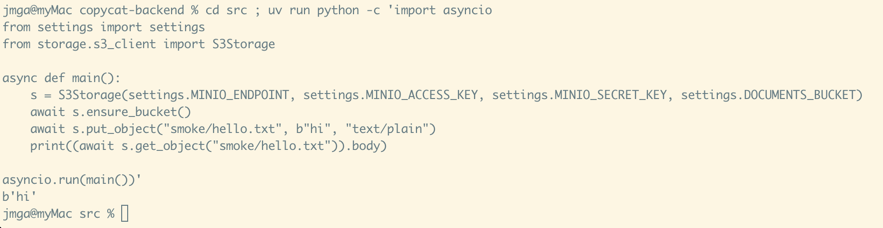
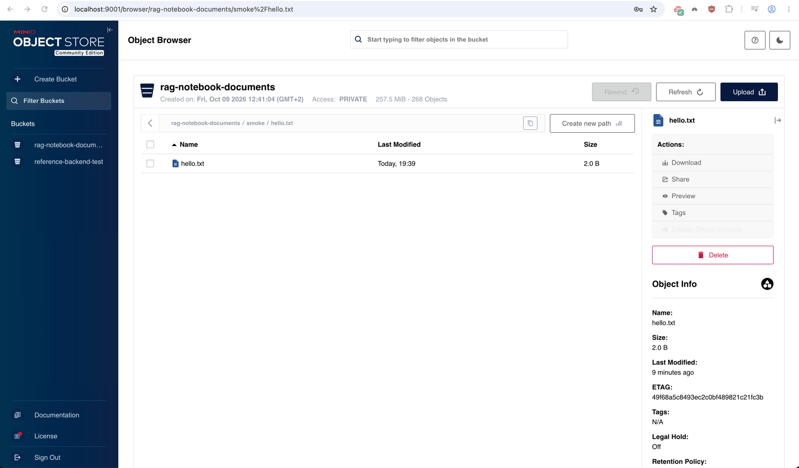
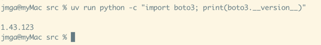
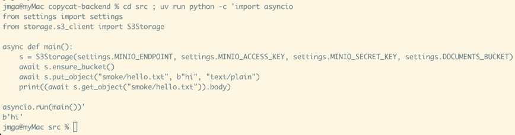
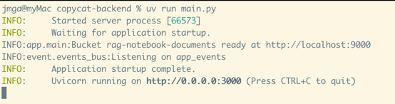
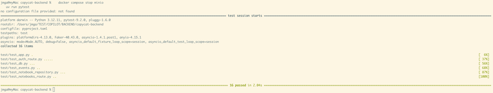

# T07 — Object storage (MinIO)

| Mode | Effort | Priority | Depends on | Unblocks | Learning value |
| --- | --- | --- | --- | --- | --- |
| Copy | 0.1 day | P1 | T01 | T08, T10 | Low |

## Why this is a copy

A thin wrapper over three boto3 calls, each run in `asyncio.to_thread`. Read it once for the
`to_thread` pattern (you will use it again in T10) and spend the time on T06.

## Why

Uploaded bytes live in MinIO under the S3 API; nothing in copycat-backend talks to it yet.

## What you need to know

### 1. boto3 against MinIO

boto3 is Amazon's S3 client. MinIO speaks the same API, so the only differences are the
`endpoint_url` and path-style addressing (`http://host:9000/bucket/key` rather than
`http://bucket.host`). Credentials are the MinIO root user and password from the compose file.

```python
import boto3
from botocore.config import Config

client = boto3.client(
    "s3",
    endpoint_url="http://localhost:9000",
    aws_access_key_id=settings.MINIO_ACCESS_KEY,
    aws_secret_access_key=settings.MINIO_SECRET_KEY,
    region_name="us-east-1",
    config=Config(
        s3={"addressing_style": "path"}, retries={"max_attempts": 5, "mode": "standard"}
    ),
)
client.put_object(
    Bucket="rag-notebook-documents",
    Key="hello.txt",
    Body=b"hi",
    ContentType="text/plain",
)
print(
    client.get_object(Bucket="rag-notebook-documents", Key="hello.txt")["Body"].read()
)  # b'hi'
```



Try it: with the compose stack up, run the snippet, then open the MinIO console on
`http://localhost:9001` and find `hello.txt` in the bucket. Log in with the `MINIO_ROOT_USER`
and `MINIO_ROOT_PASSWORD` of the compose file.

If `:9001` answers an empty reply, the console is switched off: the `bitnamilegacy/minio` image
defaults `MINIO_BROWSER` to `off`, and MinIO then ignores the `--console-address` its own start
script passes. The compose file in `NOTEBOOKS` sets `MINIO_BROWSER: "on"` for that reason; after
changing it, `docker compose up -d minio` recreates the container (the data volume survives).




### 2. Blocking calls inside asyncio

boto3 is synchronous: a call blocks the thread. Inside a FastAPI route that would freeze every
other request for the duration of the upload. `asyncio.to_thread(fn, *args, **kwargs)` runs the
call in a worker thread and gives back an awaitable, so the event loop keeps serving.

```python
import asyncio


async def get_bytes(key: str) -> bytes:
    def read() -> bytes:
        return client.get_object(Bucket=BUCKET, Key=key)["Body"].read()

    return await asyncio.to_thread(read)
```

A nested `def` is the usual way to bundle a call plus the `.read()` into one unit of work.

### 3. One instance on `app.state`, handed out by a dependency

Objects created once at startup live on `app.state`. Routes do not import them; they ask for them
through a dependency that reads `request.app.state`. Tests then replace the attribute with a fake
and the routes never notice.

```python
from fastapi import Request


def get_storage(request: Request) -> S3Storage:
    return request.app.state.storage


@router.post("/upload")
async def upload(storage: S3Storage = Depends(get_storage)): ...
```

## What to copy

1. **Add the dependency.** `uv add boto3` (the reference pins `boto3>=1.40.0`).

   **DONE WHEN:** this prints a version:

   ```sh
   uv run python -c "import boto3; print(boto3.__version__)"
   ```


2. **Copy the client.** Copy `reference-backend/src/storage/s3_client.py` to
   `src/storage/s3_client.py` as is. It gives `S3Storage(endpoint, access_key, secret_key, bucket)`
   with three async methods: `ensure_bucket()` (head, create on failure), `put_object(key, body,
   content_type)` and `get_object(key) -> StoredObject(body, content_length)`. Make sure
   `settings` has `MINIO_ENDPOINT`, `MINIO_ACCESS_KEY`, `MINIO_SECRET_KEY` and `DOCUMENTS_BUCKET`
   (T01); the values are in the NOTEBOOKS `.env` and compose file.

   **DONE WHEN:** this script prints `b'hi'`:

   ```python
   import asyncio
   from settings import settings
   from storage.s3_client import S3Storage


   async def main():
       s = S3Storage(
           settings.MINIO_ENDPOINT,
           settings.MINIO_ACCESS_KEY,
           settings.MINIO_SECRET_KEY,
           settings.DOCUMENTS_BUCKET,
       )
       await s.ensure_bucket()
       await s.put_object("smoke/hello.txt", b"hi", "text/plain")
       print((await s.get_object("smoke/hello.txt")).body)


   asyncio.run(main())
   ```

   Run it from `src/` with `uv run python -c "..."` or as a file with `PYTHONPATH=src`.




3. **Wire the lifespan and the dependency.** In `app/main.py`'s lifespan build the storage from
   `settings`, `await storage.ensure_bucket()`, then `app.state.storage = storage`. Put
   `get_storage(request)` next to the routes that use it (the reference keeps it in
   `document_router.py`). In `test/conftest.py` (T05) add the in-memory `FakeStorage` with the same
   two methods, dict-backed, and set `app.state.storage = FakeStorage()` in the `client` fixture.

   **DONE WHEN:** the server boots and logs no bucket error; the MinIO console shows the
   `rag-notebook-documents` bucket; and the suite still passes with no MinIO running:

   ```sh
   docker compose stop minio
   uv run pytest
   ```





## Acceptance

- Starting the server against the compose MinIO creates the `rag-notebook-documents` bucket
  (visible in the MinIO console on :9001).

## References

- Node: `apps/backend/src/storage/s3-client.ts`. Reference:
  `FakeStorage` in `test/conftest.py`.
- boto3 docs: "S3 client" (`put_object`, `get_object`, `head_bucket`). Python docs: `asyncio.to_thread`.
