# T08 — Documents: upload, versions, reads, delete and restore

| Mode | Effort | Priority | Depends on | Unblocks | Learning value |
| --- | --- | --- | --- | --- | --- |
| Write the repository, copy the routes and DTOs | 1 day | P1 | T04, T07 | T09, T16 | Medium |

## Learning value

The repository is the SQLAlchemy lesson of the plan: raw SQL through `text()`, a lateral join for
the latest Version, the `searchable_versions` CTE, an `ON CONFLICT ... WHERE deleted_at IS NULL`
upsert on a partial index, and a restore collision caught as `IntegrityError`. The eight routes and
the DTOs repeat T04's shape and are copied.

## Why

The Document routes are the largest router (eight operations) and the entry point of the whole
ingestion pipeline. `document_router.py` is all stubs; the DTOs exist but `latestVersion` and
`version` are typed `dict[str, Any]`.

## What you need to know

### 1. Raw SQL with `text()` and bound parameters

SQLAlchemy's ORM is good for simple rows; the Document queries are not simple, so they are written
as SQL strings. `text()` wraps the string and `:name` placeholders are bound from a dict. Never
build SQL with f-strings from user data; f-strings are only used below to join constant fragments.

```python
from sqlalchemy import text

rows = await db.execute(
    text(
        "SELECT id, filename FROM documents WHERE notebook_id = :nb AND deleted_at IS NULL"
    ),
    {"nb": notebook_id},
)
for row in rows:  # each row has attributes named after the columns
    print(row.id, row.filename)
one = (
    await db.execute(text("SELECT id FROM documents WHERE id = :id"), {"id": x})
).first()  # Row or None
new_id = (
    await db.execute(text("INSERT ... RETURNING id"), params)
).scalar_one()  # one value
```

### 2. Soft deletes and "is the Notebook still there"

Nothing is ever `DELETE`d. Rows have a `deleted_at` timestamp; "live" means `deleted_at IS NULL`.
A deleted Notebook keeps its Documents, so every by-id read must also check the Notebook. Per
the rule set in T04 step 1, write that check out in each query: join `notebooks` and test its
own `deleted_at`. The reference backend uses a `notebook_is_active()` helper instead; when copying
its SQL, replace each `{notebook_is_active('d.notebook_id')}` with the join below.

```sql
SELECT ... FROM documents d
JOIN notebooks n ON n.id = d.notebook_id AND n.deleted_at IS NULL
WHERE d.id = :id AND d.deleted_at IS NULL
```

### 3. The latest Version per Document: `JOIN LATERAL`

A Document has many Versions and the list shows only the newest live one. A lateral subquery runs
once per outer row and may reference it, so "top 1 per group" is one join instead of a window
function.

```sql
SELECT d.id, d.filename, v.id AS version_id, v.version_number
FROM documents d
JOIN LATERAL (
  SELECT id, version_number FROM document_versions
  WHERE document_id = d.id AND deleted_at IS NULL
  ORDER BY version_number DESC LIMIT 1
) v ON true
WHERE d.notebook_id = :notebook_id AND d.deleted_at IS NULL
```

Try it in `psql` on the dev database after uploading a file twice through the Node backend: one
row per Document, `version_number` 2.

### 4. A CTE shared by search and chat: `searchable_versions`

A `WITH name AS (...)` block defines a named subquery for the rest of the statement. The
`searchable_versions` CTE applies two rules in order: pick each Document's latest live Version,
then keep it only if it is `ready`. Keep it as a module constant and prefix it to the queries of
T16 (`WITH {SEARCHABLE_VERSIONS_CTE} SELECT ...`). Read NOTEBOOKS `docs/versioning.md` for why the
order of the two rules matters.

### 5. Upsert on a partial unique index

Migration 0004 creates `CREATE UNIQUE INDEX ... ON documents (notebook_id, filename) WHERE deleted_at IS NULL`.
An `INSERT ... ON CONFLICT` can target that index by repeating its columns and its `WHERE`. The
effect: re-uploading a live filename hits the existing Document; uploading after a delete creates
a new one. `DO UPDATE SET filename = EXCLUDED.filename` is a no-op write that makes `RETURNING id`
return the existing id too.

```sql
INSERT INTO documents (notebook_id, filename) VALUES (:notebook_id, :filename)
ON CONFLICT (notebook_id, filename) WHERE deleted_at IS NULL
DO UPDATE SET filename = EXCLUDED.filename
RETURNING id
```

Try it: run it twice in `psql` with the same values; both return the same id.

### 6. Letting the database detect the restore collision

Restoring a deleted Document (`SET deleted_at = NULL`) can violate that same index if a new
Document with the filename was uploaded meanwhile. A check-then-update would still race with a
concurrent upload, so let the write fail and catch `IntegrityError`.

```python
from sqlalchemy.exc import IntegrityError

try:
    result = await db.execute(
        text(
            "UPDATE documents SET deleted_at = NULL WHERE id = :id AND deleted_at IS NOT NULL"
        ),
        {"id": doc_id},
    )
    await db.commit()
except IntegrityError:
    await db.rollback()  # the session is unusable until this
    return "filename-taken"
if result.rowcount != 1:  # nothing to restore
    return "not-found"
```

`result.rowcount` is the number of rows an UPDATE touched; pyright does not know `execute()`
returns a `CursorResult`, so the reference wraps it in `db/postgresql.py::rowcount(result)`.

### 7. Multipart uploads and binary downloads in FastAPI

`UploadFile` reads a multipart form part lazily. Reading one byte more than the cap is the cheap
way to enforce a size limit without a `Content-Length` header. A download is a plain `Response`
with the stored MIME type and a `Content-Disposition` header.

```python
from typing import Annotated
from urllib.parse import quote
from fastapi import File, HTTPException, UploadFile
from fastapi.responses import Response


@router.post("/up", status_code=201)
async def up(file: Annotated[UploadFile, File()]):
    body = await file.read(MAX + 1)
    if len(body) > MAX:
        raise HTTPException(413, "Too large.")
    return {"filename": file.filename, "size": len(body)}


@router.get("/down")
async def down():
    return Response(
        content=b"...",
        media_type="application/pdf",
        headers={
            "Content-Disposition": f'attachment; filename="{quote("report.pdf")}"'
        },
    )
```

Try it with the T05 client: `await client.post("/up", files={"file": ("notes.txt", b"hello", "text/plain")})`.
`python-multipart` must be installed for `UploadFile` to work (it is in `pyproject.toml`).

### 8. Response DTOs with camelCase

Every response model is a pydantic class with snake_case fields and
`Field(serialization_alias="camelCase")`. FastAPI serializes with aliases when the route declares
`response_model=`. Build them by keyword from the SQL row in a small `to_document(row)` function.

## What to copy

1. **DTOs.** Copy `reference-backend/src/document/document_dto.py` over `src/document/document_dto.py`:
   `DocumentStatus`, `FailureReason`, `FailedAt` literals, `DocumentFailure`, `DocumentVersion`,
   `DocumentResponse`, `DocumentDetailResponse`, `DocumentVersionDetailResponse`,
   `DocumentVersionContentResponse`. Delete `RetryIngestionResponse` and `RETRYABLE_FAILURE_REASONS`
   (T14 is dropped) and the generated `UploadDocumentResponse`, `GetDocumentResponse`, `RestoreDocumentResponse`
   names, which the copied router no longer imports.

   **DONE WHEN:** from `src/`, the import runs and the *serialization* schema lists `latestVersion`
   and `notebookId`:

   ```sh
   cd src && uv run python -c "from document.document_dto import DocumentResponse; print(list(DocumentResponse.model_json_schema(by_alias=True, mode='serialization')['properties']))"
   ```

   `mode='serialization'` matters: these DTOs use `serialization_alias`, which renames fields on
   output only, so the default (validation) schema still shows `notebook_id` and `latest_version`.
   FastAPI builds response schemas in serialization mode, which is why the OpenAPI document and
   the JSON on the wire are camelCase while Python code keeps `created_at`.


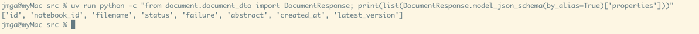


2. **File types and the CTE.** Copy `file_types.py` (extension to MIME map, the two rejection
   messages, `MAX_UPLOAD_FILE_BYTES = 50 MiB`) and `searchable_versions.py` (section 4) as they are.

   **DONE WHEN:** from `src/`, the assertions hold and the CTE runs against the dev database:

   ```sh
   cd src && uv run python -c "
   from document.file_types import resolve_accepted_mime_type, describe_rejected_file_type, MAX_UPLOAD_FILE_BYTES
   assert resolve_accepted_mime_type('x.PDF') == 'application/pdf'
   assert resolve_accepted_mime_type('x.xls') is None
   assert '.xlsx' in describe_rejected_file_type('x.xls')
   assert MAX_UPLOAD_FILE_BYTES == 50 * 1024 * 1024
   print('file_types ok')
   "
   ```
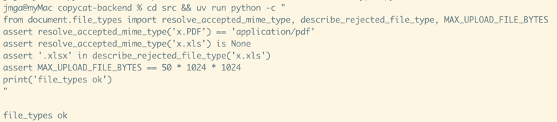

   ```sh
   cd src && uv run python -c "
   import asyncio
   from sqlalchemy import text
   from db import AsyncSessionLocal
   from document.searchable_versions import SEARCHABLE_VERSIONS_CTE
   async def main():
       async with AsyncSessionLocal() as db:
           nb = (await db.execute(text('SELECT id FROM notebooks WHERE deleted_at IS NULL LIMIT 1'))).scalar_one()
           sql = text(f'WITH {SEARCHABLE_VERSIONS_CTE} SELECT count(*) FROM searchable_versions')
           n = (await db.execute(sql, {'notebook_id': nb})).scalar_one()
           print('searchable_versions ok:', n, 'ready Versions in notebook', nb)
   asyncio.run(main())
   "
   ```

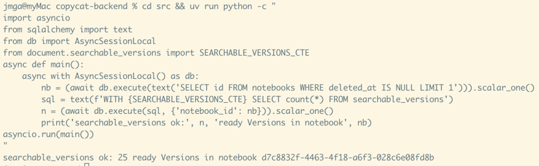

   The constant is a bare `searchable_versions AS (...)` block, not a full query: the repository
   writes `WITH {SEARCHABLE_VERSIONS_CTE} SELECT ...` and binds `:notebook_id`. Note that it does
   not check the Notebook's own `deleted_at`; the routes that use it call `notebook_exists` first.

3. **Router.** Copy `document_router.py`, then delete the `retry_ingestion` route and its imports.
   Seven routes remain, all behind `CurrentUser`: list (404 unknown Notebook), upload (404, 400 on
   type, 413 on size; key `notebooks/<nb>/<uuid4>-<filename>`; `enqueue_conversion` after the
   repository commit, a no-op while `app.state.jobs` is missing until T09), get, delete, restore
   (409 names the filename), version detail, content, download. The router expects `get_storage`
   (T07) and the repository methods named in the next section, so it will not import until the
   repository exists; write the repository with those names.

   **DONE WHEN:** ruff is clean on the folder and the app imports:

   ```sh
   uv run ruff check src/document
   cd src && uv run python -c "import app.main"
   ```

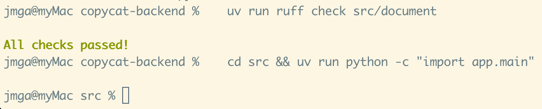

## What to write

**The file.** `src/document/document_repository.py` already exists as a skeleton.\
It holds `DocumentRepository` with the eight methods the router calls, each raising `NotImplementedError`.\
It also holds the two result types the router reads: `DownloadableVersion` and `RestoreResult`.\
The five steps below fill the methods in, in order.\
Keep the signatures: the router and pyright depend on them.\
Do not open the reference's version until the tests of step 5 pass; then diff.

**Three rules for every query in this file.**

- All SQL is `text()` with `:name` parameters bound from a dict (section 1).
  f-strings only glue together the constant fragments defined at the top of the module.
- Every query joins the Notebook and checks it is live:
  `JOIN notebooks n ON n.id = d.notebook_id AND n.deleted_at IS NULL` (section 2, T04 step 1).
  A deleted Notebook keeps its Documents, and nothing else in these tables says the Notebook is gone.
- Every DONE WHEN runs on the T05 harness, through the `client` fixture, and leaves no rows behind.
  The dev database already holds Documents of its own, so never assert on table-wide counts.

---

### Step 1. The list query and the row mapper

**Add to the module**

- A constant `SELECT_DOCUMENTS_WITH_LATEST_VERSION`: the SELECT every Document read starts from.
- A function `to_version(row) -> DocumentVersion`.
- A function `to_document(row) -> DocumentResponse`.
- The method `list_documents(notebook_id)`.

**SQL: the value of `SELECT_DOCUMENTS_WITH_LATEST_VERSION`**

This constant is a prefix, not a complete query: it stops before any `WHERE`.\
Each method that uses it appends its own `WHERE` (and `ORDER BY`) with an f-string, for example:

```python
text(
    f"{SELECT_DOCUMENTS_WITH_LATEST_VERSION} WHERE d.notebook_id = :notebook_id AND d.deleted_at IS NULL ORDER BY d.created_at"
)
```

Steps 2 and 3 reuse it the same way with different filters.

```sql
SELECT d.id, d.notebook_id, d.filename, d.created_at,
       v.id AS version_id, v.version_number, v.mime_type, v.size_bytes, v.created_at AS version_created_at,
       v.ingestion_status, v.failure_reason, v.failed_at,
       v.abstract, v.chat_snippet, v.executive_summary, v.metadata
FROM documents d
JOIN notebooks n ON n.id = d.notebook_id AND n.deleted_at IS NULL
JOIN LATERAL (
  SELECT id, version_number, mime_type, size_bytes, created_at, ingestion_status,
         failure_reason, failed_at, abstract, chat_snippet, executive_summary, metadata
  FROM document_versions
  WHERE document_id = d.id AND deleted_at IS NULL
  ORDER BY version_number DESC
  LIMIT 1
) v ON true
```

**Why it looks like this**

- `JOIN LATERAL ... LIMIT 1` picks each Document's latest live Version (section 3).
- `v.id` and `v.created_at` are aliased because the Document has an `id` and a `created_at` too; the DTOs need both pairs.
- `v.markdown` is left out on purpose: one real Version in the dev database holds 1.6 million characters of it.
  Step 3 fetches it for one Version at a time.
- `v.ingestion_error` is left out on purpose: it is the operator's record and never leaves the backend.

**Mapping**

`to_version(row)` builds `DocumentVersion` from the `v.*` columns:

| DTO field | from |
| --- | --- |
| `id` | `row.version_id` |
| `version_number` | `row.version_number` |
| `mime_type` | `row.mime_type` |
| `size_bytes` | `row.size_bytes` (a `bigint`; asyncpg returns `int`) |
| `created_at` | `row.version_created_at` |

`to_document(row)` builds `DocumentResponse`:

| DTO field | from |
| --- | --- |
| `id`, `notebook_id`, `filename`, `created_at` | the `d.*` columns of the same name |
| `status` | `row.ingestion_status` |
| `abstract` | `row.abstract` |
| `latest_version` | `to_version(row)` |
| `failure` | see below |

- `failure` is `DocumentFailure(reason=row.failure_reason or "unexpected", failed_at=row.failed_at)` **only when** `row.ingestion_status == "failed"`.
  Otherwise it is `None`.
- Both DTOs have `populate_by_name=True`: construct them with the snake_case names above; the JSON still comes out camelCase.

**The method**

- `list_documents(notebook_id)` runs the constant plus\
  `WHERE d.notebook_id = :notebook_id AND d.deleted_at IS NULL ORDER BY d.created_at`\
  and returns `[to_document(row) for row in rows]`.
- A Document whose every Version is deleted has no lateral row and drops out of the list.
  That is the intended meaning of "no live Version".

**DONE WHEN**

- In a Notebook from `create_notebook(client)`, upload `a.txt` then `b.txt` with the `upload()` helper of step 5.
- `GET .../documents` answers 200 with two items, in that order.
- Each item has `status: "queued"`, `failure: null`, `abstract: null` and `latestVersion.versionNumber == 1`.
- Listing a random `uuid4()` Notebook answers 404 (the router's `notebook_exists` check, already in place).

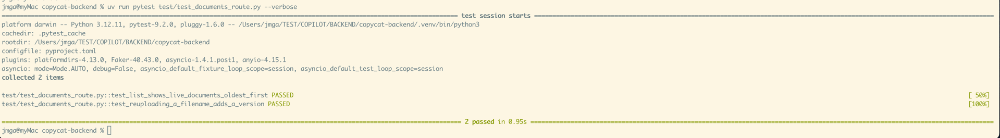

---

### Step 2. Create

**Add to the module**

- A private method `_find_document(notebook_id, document_id) -> DocumentResponse | None`.
- The method `create_document_version(notebook_id, filename, mime_type, size_bytes, storage_key) -> DocumentResponse`.

**SQL, statement 1: find or create the Document** (section 5)

```sql
INSERT INTO documents (notebook_id, filename) VALUES (:notebook_id, :filename)
ON CONFLICT (notebook_id, filename) WHERE deleted_at IS NULL
DO UPDATE SET filename = EXCLUDED.filename
RETURNING id
```

- The partial unique index `(notebook_id, filename) WHERE deleted_at IS NULL` is what makes this a "find or create".
- A live Document with this filename exists: the INSERT conflicts, the no-op `DO UPDATE` runs, and `RETURNING id` gives the existing id.
- None exists (never uploaded, or deleted since): a new row is created and its id returned.
- Read the id with `.scalar_one()`.

**SQL, statement 2: add the Version**

```sql
INSERT INTO document_versions (document_id, version_number, mime_type, size_bytes, storage_key)
VALUES (:document_id,
        (SELECT COALESCE(MAX(version_number), 0) + 1 FROM document_versions WHERE document_id = :document_id),
        :mime_type, :size_bytes, :storage_key)
```

- The number is computed in SQL, so two concurrent uploads of the same Document cannot pick the same one.
  The unique constraint on `(document_id, version_number)` rejects the loser.
- `ingestion_status` is not set: the column defaults to `queued`, which is what the response must show.

**Then**

1. `await self.db.commit()`.
2. Re-read the Document with `_find_document`, which is the step 1 constant plus\
   `WHERE d.id = :id AND d.notebook_id = :notebook_id`, mapped with `to_document`.
3. It cannot be `None` right after the commit: `assert` that and return it.

**Where this sits in the upload**

- The route calls it after `storage.put_object` succeeded and before enqueueing the conversion.
- So a failure here can leave an orphan object in MinIO, but never a Version without bytes.
- And a Version row always exists before anything tries to convert it.

**DONE WHEN**

- Upload `notes.txt` twice in one Notebook.
- Both answer 201 with the same `id`.
- `latestVersion.versionNumber` is 1, then 2.
- Listing the Notebook shows one Document.

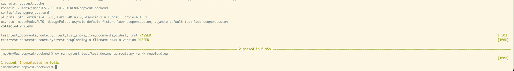

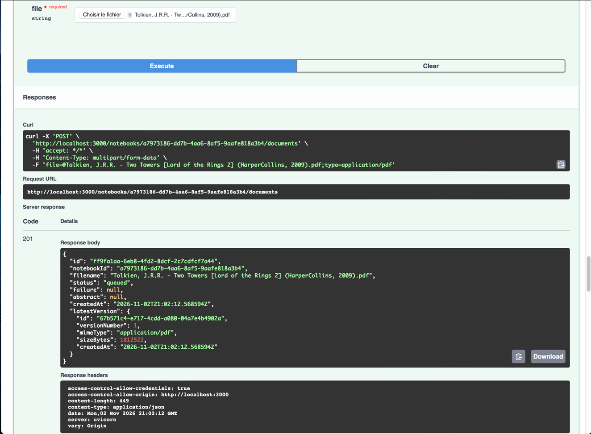

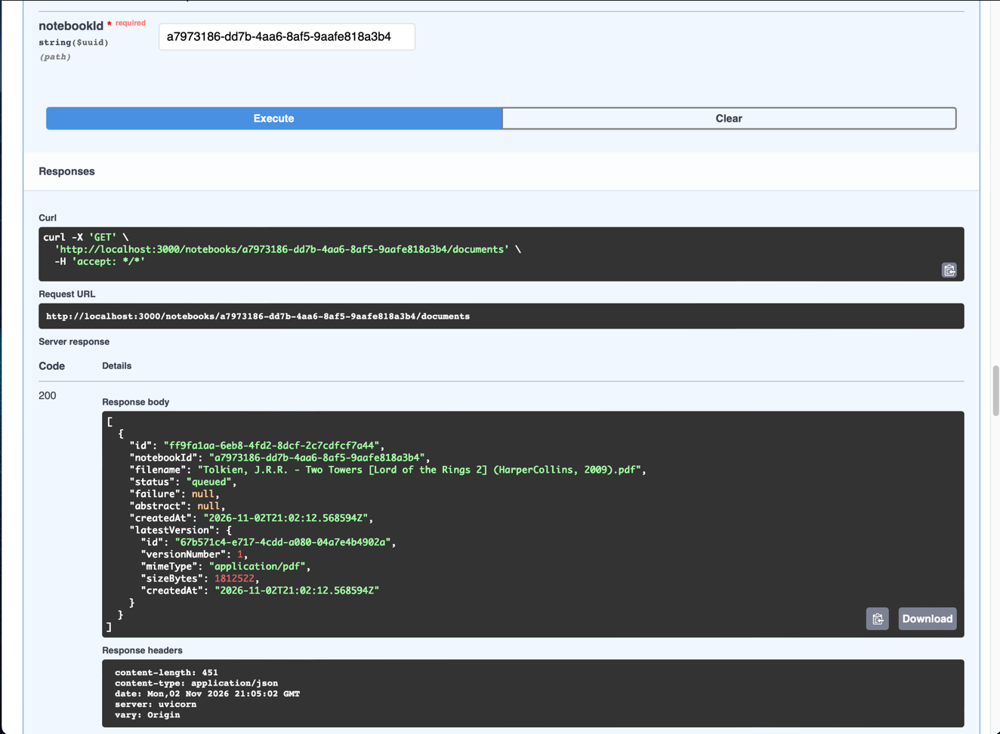

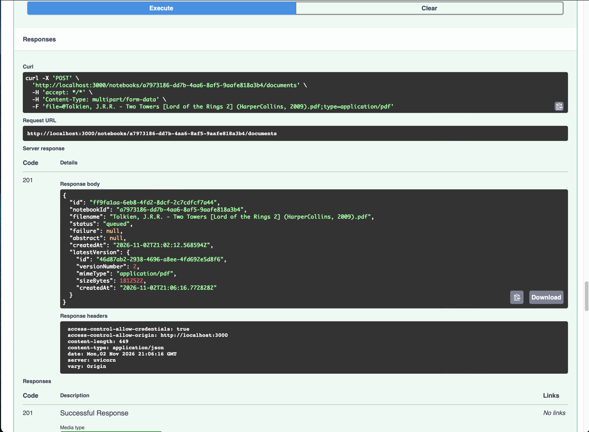

---

### Step 3. Detail and the three Version-scoped reads

**Add to the module**

- A constant `SELECT_VERSION`.
- A private method `_version_row(notebook_id, document_id, version_id)`.
- The methods `find_document_detail`, `find_document_version_detail`, `find_document_content`, `find_downloadable_version`.

**`find_document_detail(notebook_id, document_id) -> DocumentDetailResponse | None`**

- SQL: the step 1 constant plus `WHERE d.id = :id AND d.notebook_id = :notebook_id AND d.deleted_at IS NULL`.
  The Notebook check is already in the constant's join.
- Mapping: `document = to_document(row)`, then\
  `DocumentDetailResponse(**document.model_dump(), metadata=row.metadata, chat_snippet=row.chat_snippet, executive_summary=row.executive_summary)`.
- `metadata` is `jsonb`; asyncpg hands it over as a `dict` already.

**SQL for the three Version routes** (the constant `SELECT_VERSION`)

```sql
SELECT d.id AS document_id, d.notebook_id, d.filename, d.created_at AS document_created_at,
       v.id AS version_id, v.version_number, v.mime_type, v.size_bytes, v.created_at AS version_created_at,
       v.ingestion_status, v.abstract, v.chat_snippet, v.executive_summary, v.metadata,
       v.markdown, v.storage_key,
       (SELECT MAX(l.version_number) FROM document_versions l
        WHERE l.document_id = d.id AND l.deleted_at IS NULL) AS latest_version_number
FROM document_versions v
JOIN documents d ON d.id = v.document_id
JOIN notebooks n ON n.id = d.notebook_id AND n.deleted_at IS NULL
WHERE v.id = :version_id AND v.document_id = :document_id AND d.notebook_id = :notebook_id
  AND v.deleted_at IS NULL
```

**Read the WHERE carefully**

- It checks that the Version is live and that the Notebook is live.
- It does **not** check that the Document is live. That is deliberate.
- A Citation (T16) points at a Version.
  If the Document was deleted after the answer was given, the Citation must still open and show what that Version said.
- Deleting the Notebook is the only thing that hides a Version.
- `markdown` and `storage_key` are selected here because this query returns at most one row.
- `latest_version_number` lets the caller say whether the named Version is still the current one.

**`_version_row(...)`** executes the constant with the three parameters and returns `.first()`: a `Row` or `None`.

**The three public methods** call `_version_row` and map the row.
Each returns `None` when the row is `None`; the router turns that into 404.

| method | returns |
| --- | --- |
| `find_document_version_detail` | `DocumentVersionDetailResponse` with `document_id`, `notebook_id`, `filename`, `document_created_at`, `version=to_version(row)`, `status=row.ingestion_status`, `abstract`, `chat_snippet`, `executive_summary`, `metadata`, `latest_version_number=row.latest_version_number`, `is_latest_version=row.version_number == row.latest_version_number` |
| `find_document_content` | `DocumentVersionContentResponse(version_id=row.version_id, markdown=row.markdown)`; `markdown` is `None` until ingestion stage 1 has run |
| `find_downloadable_version` | `DownloadableVersion(row.storage_key, row.mime_type, row.filename)`; the route fetches the bytes from storage with that key |

**DONE WHEN**, for a fresh upload:

- `GET .../versions/{id}` answers `isLatestVersion: true` and `latestVersionNumber: 1`.
- `GET .../versions/{id}/content` answers `{"versionId": ..., "markdown": null}`.
- `GET .../versions/{id}/download` answers 200 with the uploaded bytes and `content-disposition: attachment; filename="notes.txt"`.
- After deleting the Document through the route, the three Version routes still answer 200.
- After `UPDATE notebooks SET deleted_at = now() WHERE id = :id` on the `db` fixture, all three answer 404.

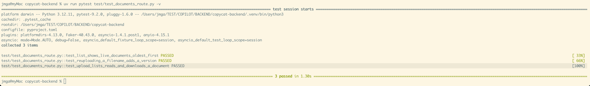

---

### Step 4. Delete and restore

**Add to the module**

- `rowcount` imported from `db` (it exists because pyright cannot see that `execute()` returns a `CursorResult`).
- `IntegrityError` imported from `sqlalchemy.exc`.
- The methods `soft_delete_document` and `restore_document`.

**`soft_delete_document(notebook_id, document_id) -> bool`**

```sql
UPDATE documents SET deleted_at = now()
WHERE id = :id AND notebook_id = :notebook_id AND deleted_at IS NULL
```

- Execute, commit, return `rowcount(result) == 1`.
- `False` means no live Document matched: unknown id, another Notebook, or already deleted.
  The router answers 404 for all three.

**`restore_document(notebook_id, document_id) -> RestoreResult`** (section 6)

```sql
UPDATE documents SET deleted_at = NULL
WHERE id = :id AND notebook_id = :notebook_id AND deleted_at IS NOT NULL
```

- If a live Document with the same filename appeared in the meantime, the partial unique index rejects this write.
- SQLAlchemy then raises `IntegrityError`, at `execute()` or at `commit()`: wrap both in one `try`.

Then decide, in this order:

1. **On `IntegrityError`.**
   First `await self.db.rollback()`: the session refuses every statement until the failed transaction is rolled back.
   Then `SELECT filename FROM documents WHERE id = :id`, to name the file in the 409 message.
   Return `RestoreResult("filename-taken", filename=...)`.
2. **Else if `rowcount(result) != 1`.**
   Nothing was deleted under that id in that Notebook.
   Return `RestoreResult("not-found")`.
3. **Else.**
   Re-read with `_find_document` and return `RestoreResult("restored", document)`.
   If the re-read is `None` (its Notebook is deleted), return `RestoreResult("not-found")`.

- The router already maps the three outcomes to 200, 404 and 409 with the filename in the message.
- In tests, the `rollback()` of case 1 rolls back to the harness's current savepoint, not the test's outer transaction.
  The rows created earlier in the same test survive.

**DONE WHEN**

- Delete answers 204, then 404 on repeat.
- Upload `a.txt`, delete it, upload `a.txt` again (a new Document, by step 2), restore the first: 409 with a message containing `"a.txt"`.
- Restoring a random `uuid4()` answers 404.


---

### Step 5. Tests

**File:** `test/test_documents_route.py`, on the T05 harness.\
The `client` fixture already installs `FakeStorage` and `FakeJobs`.\
So uploads and downloads need no MinIO, and the enqueue of a conversion can be asserted.

**One helper**

```python
async def upload(
    client: AsyncClient,
    notebook_id: str,
    filename: str = "notes.txt",
    content: bytes = b"hello world",
) -> dict:
    response = await client.post(
        f"/notebooks/{notebook_id}/documents",
        files={"file": (filename, content, "text/plain")},
    )
    assert response.status_code == 201, response.text
    return response.json()
```

**Four tests.** Each starts with `await sign_in(client)` and `notebook = await create_notebook(client)`.

| test | covers |
| --- | --- |
| `test_upload_lists_reads_and_downloads_a_document` | the DONE WHENs of steps 1 and 3 in one flow: upload, list, detail with `executiveSummary: null`, version, content, download; plus `app.state.jobs.enqueued == [(UUID(document id), UUID(version id))]`, with `app` imported from `app.main` |
| `test_reuploading_a_filename_adds_a_version` | the DONE WHEN of step 2 |
| `test_upload_refuses_unsupported_types_and_unknown_notebooks` | `book.xls` answers 400 with `"Legacy Excel"` in the message; a random Notebook id answers 404 |
| `test_delete_and_restore_a_document` | the DONE WHEN of step 4, plus `GET` on the deleted Document answers 404 |

**DONE WHEN**

```sh
uv run pytest test/test_documents_route.py -q
```

The Document route tests are green and run in a few seconds.


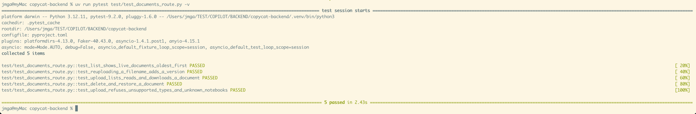


## Acceptance

- All seven `/notebooks/{notebookId}/documents...` operations answer the contract's codes and shapes;
  an uploaded file comes back byte-for-byte from the download route.

## References

- Node: `apps/backend/src/documents/*.ts`; `docs/versioning.md`.
- Reference: `BACKEND/reference-backend/src/document/`, `test/test_documents_route.py`.
- Postgres docs: `INSERT ... ON CONFLICT` (partial index inference), `LATERAL` subqueries, `WITH` queries.
- SQLAlchemy docs: "Using textual SQL" (`text()`, bound parameters), `CursorResult.rowcount`.
