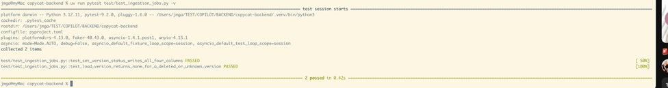
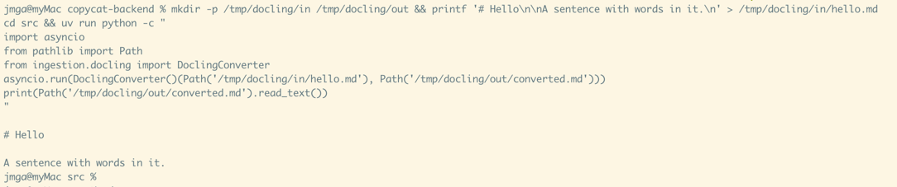
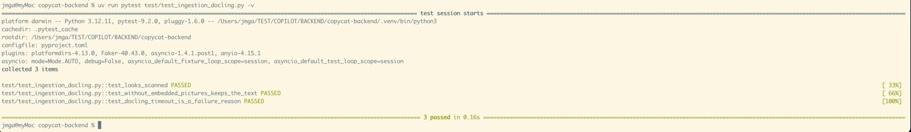
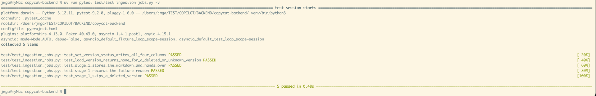
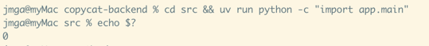
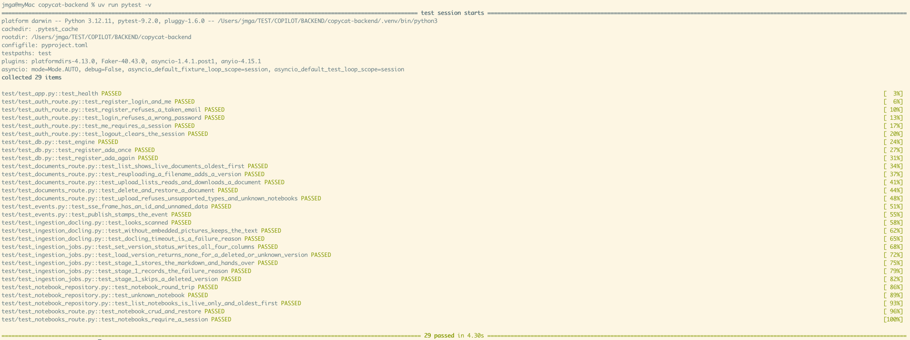

# T10 — Ingestion stage 1: conversion to Markdown with Docling

| Mode | Effort | Priority | Depends on | Unblocks | Learning value |
| --- | --- | --- | --- | --- | --- |
| Write | 1 day | P1 | T06, T09 | T12 | High |

## Learning value

Driving a Docker container from asyncio with bind mounts, timeouts and exit-code handling; transactional status updates that publish events. Also the first full stage, which the next two copy.

## Why

Stage 1 turns an upload into Converted Markdown, the single input every later Stage reads. It
runs Docling as a one-shot Docker container (`ghcr.io/docling-project/docling-serve-cpu:v1.1.0`,
see NOTEBOOKS `docs/ingestion-docling.md`).

## What you need to know

### 1. Running a subprocess from asyncio

`asyncio.create_subprocess_exec` starts a program without blocking the event loop. Pass the
arguments as a list (no shell, no quoting problems). `communicate()` waits for it to exit and
returns its output. Wrap the wait in `asyncio.wait_for` to get a timeout, and kill the process
when the timeout fires or it keeps running.

```python
import asyncio


async def run(*args: str, timeout_s: float) -> tuple[int, str]:
    proc = await asyncio.create_subprocess_exec(
        *args, stdout=asyncio.subprocess.PIPE, stderr=asyncio.subprocess.STDOUT
    )
    try:
        out, _ = await asyncio.wait_for(proc.communicate(), timeout=timeout_s)
    except TimeoutError:
        proc.kill()
        raise
    return proc.returncode or 0, out.decode(errors="replace")


print(asyncio.run(run("echo", "hello", timeout_s=5)))  # (0, 'hello\n')
```

Try it: save the snippet as `/tmp/run.py` and `uv run python /tmp/run.py`. Then try `run("sleep", "3", timeout_s=1)` and watch `TimeoutError` come out.

### 2. One-shot `docker run` with bind mounts

`--rm` deletes the container when it exits, `--volume host:container[:ro]` mounts a host file or
directory, `--network none` cuts it off from the network, `--entrypoint docling` replaces the
image's HTTP server with the CLI. Docling writes `<input stem>.md` into the output directory.

```bash
mkdir -p /tmp/docling-out
docker run --rm --init --network none \
  --volume "$PWD/README.md:/work/in/README.md:ro" \
  --volume /tmp/docling-out:/work/out \
  --entrypoint docling ghcr.io/docling-project/docling-serve-cpu:v1.1.0 \
  --artifacts-path /opt/app-root/src/.cache/docling/models \
  --table-mode fast --to md --output /work/out /work/in/README.md
cat /tmp/docling-out/README.md
```

Two traps, both documented in `docs/ingestion-docling.md`: without `--artifacts-path` every PDF
fails after ten seconds trying to download models, and the CLI can log "failed to convert" and
still exit 0. So check that the output file exists, not only the exit code.

### 3. Temporary directories and `pathlib`

Each conversion gets its own directory under the system temp folder, deleted in a `finally`.
Keep the original filename: Docling picks its parser from the extension.

```python
import shutil, tempfile
from pathlib import Path

work_dir = Path(tempfile.mkdtemp(prefix="nbk-convert-"))
try:
    input_path = work_dir / "report.pdf"
    input_path.write_bytes(b"...")  # the bytes from MinIO
    output_path = work_dir / "converted.md"
    print(input_path.stem, input_path.suffix)  # report .pdf
finally:
    shutil.rmtree(work_dir, ignore_errors=True)
```

### 4. Typed exceptions carry the failure reason

The frontend shows one of five reasons (`no-text-layer`, `unreadable`, `timed-out`,
`service-unavailable`, `unexpected`, migration 0012). An exception subclass with a `reason`
attribute lets the job record the right one without a chain of `if isinstance`.

```python
class IngestionFailure(Exception):
    def __init__(self, reason: str, message: str):
        super().__init__(message)
        self.reason = reason


try:
    raise IngestionFailure("timed-out", "Docling timed out.")
except Exception as err:
    reason = err.reason if isinstance(err, IngestionFailure) else "unexpected"
    print(reason, str(err))  # timed-out Docling timed out.
```

### 5. One UPDATE, one `pg_notify`, one commit

`pg_notify` is transactional. Issued inside the same transaction as the status UPDATE, the event
is only delivered if the commit succeeds, so the browser never hears about a status that was
rolled back. T06 gave you `publish_app_event(db, draft)`; call it right after the UPDATE, then
`commit()`.

```python
await db.execute(
    text("UPDATE document_versions SET ingestion_status = :s WHERE id = :id"), {...}
)
await publish_app_event(
    db,
    AppEventDraft(
        type="document-version-status-changed", topic=f"notebook:{nb}", data={...}
    ),
)
await db.commit()
```

Migration 0012 adds a check: `failure_reason` and `failed_at` must be NULL unless the status is
`failed`. Writing all four columns in one UPDATE keeps that true on every transition.

### 6. A callable as the seam for tests

The job must not know whether Docling or a test fake does the conversion. Define the converter as
a type alias for an async callable taking two paths, and inject it through a dataclass of
dependencies. Tests pass an `async def` that writes the output file.

```python
from collections.abc import Awaitable, Callable
from dataclasses import dataclass
from pathlib import Path

MarkdownConverter = Callable[[Path, Path], Awaitable[None]]


@dataclass
class ConvertToMarkdownDeps:
    db: AsyncSession
    storage: S3Storage
    convert_to_markdown: MarkdownConverter
    enqueue_summarize_document: (
        Callable[[DocumentVersionRef], Awaitable[None]] | None
    ) = None
```

## What to build

**Files.** Four modules in `src/ingestion/`: `stage.py` (exists since T09, extended here), `embedded_pictures.py`, `docling.py`, `convert_to_markdown.py`.\
Three new settings in `src/settings.py`.\
One test file, `test/test_ingestion_jobs.py`.\
The three queue names and `DocumentVersionRef` already live in `stage.py` with underscore names (`convert_to_markdown`); keep them, the jobs table already uses them.

---

### Step 1. `ingestion/stage.py`: what all three Stages share

**Add to the module** (keep what T09 put there):

- `DOCUMENT_VERSION_STATUS_CHANGED = "document-version-status-changed"`, the event type.
- `IngestionVersion`, a frozen dataclass.
- `IngestionFailure`, an exception class.
- `load_version(db, ref, *columns)`.
- `set_version_status(db, version, status, *, error=None, failed_at=None, **columns)`.

**`IngestionVersion`**: `notebook_id`, `document_id`, `version_id`, `filename`.\
A job starts with only a `DocumentVersionRef` (two ids); this is the ref plus the two facts an event needs to name the Version to the browser.

**`IngestionFailure(reason, message)`**: section 4, with `reason` typed `FailureReason` from `document_dto`.\
Anything else a Stage raises is recorded as `"unexpected"`.

**`load_version(db, ref, *columns) -> Row | None`**: the Stage's input row.

```python
async def load_version(db: AsyncSession, ref: DocumentVersionRef, *columns: str) -> Any:
    selected = ", ".join(f"v.{c}" for c in columns)
    sql = text(
        f"SELECT d.notebook_id, d.filename, {selected} FROM document_versions v"
        " JOIN documents d ON d.id = v.document_id"
        " WHERE v.id = :version_id AND v.document_id = :document_id AND v.deleted_at IS NULL"
    )
    return (
        await db.execute(
            sql, {"version_id": ref.version_id, "document_id": ref.document_id}
        )
    ).first()
```

- Each Stage asks for the columns it needs: `load_version(db, ref, "storage_key")` here, `"markdown"` in T12.
- The column names come from the Stage's code, never from a user, which is why an f-string is acceptable.
- `None` means the Version was deleted between enqueue and now: nothing to do, nothing to retry.
- No Notebook check here on purpose: a job that was enqueued finishes its work even if the Notebook was deleted meanwhile; the routes hide the result.

**`set_version_status(...)`**: one UPDATE, one event, one commit (section 5).\
It writes the four status columns on *every* call, so migration 0012's check (`failure_reason` and `failed_at` NULL unless `failed`) can never be violated by a leftover value.

| column | value |
| --- | --- |
| `ingestion_status` | `status` |
| `ingestion_error` | `str(error)`, or NULL when `error` is None |
| `failure_reason` | when `status == "failed"`: `error.reason` for an `IngestionFailure`, `"unexpected"` for any other error; otherwise NULL |
| `failed_at` | `failed_at` when `status == "failed"`, otherwise NULL |
| every `**columns` keyword | `name = :name` appended to the SET list (Stage outputs: `markdown`, `converted_at`, later `abstract`, ...) |

```python
assignments = ", ".join(f"{name} = :{name}" for name in columns)
sql = text(
    "UPDATE document_versions SET ingestion_status = :status, ingestion_error = :error,"
    f" failure_reason = :reason, failed_at = :failed_at{', ' + assignments if assignments else ''}"
    " WHERE id = :id"
)
await db.execute(
    sql,
    {
        "id": version.version_id,
        "status": status,
        "error": ...,
        "reason": reason,
        "failed_at": ...,
        **columns,
    },
)
```

Then the event, on the same session, then `commit()`:

- `type`: `DOCUMENT_VERSION_STATUS_CHANGED`; `topic`: `notebook_topic(version.notebook_id)`.
- `data`: `{"notebookId", "documentId", "versionId", "filename", "status"}`, the ids as `str`.
- when failed, also `data["failure"] = {"reason": reason, "failedAt": failed_at}`, the shape `DocumentFailure` has.
- `publish_app_event(db, AppEventDraft(...))` from T06, then `await db.commit()`.
  Because `pg_notify` is transactional, the browser hears about the status only once it is committed.

**DONE WHEN:** a test on the `db` fixture (the first test of step 4's file; write it now) seeds a `queued` Version and calls:

```python
await set_version_status(db, version, "converting")
await set_version_status(
    db, version, "failed", error=RuntimeError("x"), failed_at="converting"
)
await set_version_status(db, version, "converted", markdown="# A")
```

and after each call reads `ingestion_status, ingestion_error, failure_reason, failed_at, markdown` back:

1. `("converting", None, None, None, None)`
2. `("failed", "x", "unexpected", "converting", None)`
3. `("converted", None, None, None, "# A")`: the third call clears the failure columns, which is the point.

The event cannot be observed inside the rolled-back test transaction; the Acceptance check at the end of this task sees the two events on `/events` for real.




---

### Step 2. `ingestion/docling.py`: the real converter

**Settings first.** Add to `settings.py`, with defaults so `.env` needs nothing new:

```python
DOCLING_IMAGE: str = "ghcr.io/docling-project/docling-serve-cpu:v1.1.0"
DOCLING_TIMEOUT_MS: int = 60 * 60_000  # one hour: a hard cap, not an expectation
DOCLING_TABLE_MODE: str = "fast"  # already there
DOCKER_BIN: str = "docker"
```

**`ingestion/embedded_pictures.py`**, one function, needed by `looks_scanned` below and by T12:

```python
_EMBEDDED_PICTURE = re.compile(r"!\[[^\]]*\]\(data:image/[^)]*\)")


def without_embedded_pictures(markdown: str) -> str:
    """Docling inlines pictures as base64 data URIs; they are not text."""
    return _EMBEDDED_PICTURE.sub("", markdown)
```

**`ingestion/docling.py`**, the module:

```python
MarkdownConverter = Callable[[Path, Path], Awaitable[None]]  # section 6: the seam

DOCLING_ARTIFACTS_PATH = "/opt/app-root/src/.cache/docling/models"
CONTAINER_INPUT_DIR = "/work/in"
CONTAINER_OUTPUT_DIR = "/work/out"
MIN_TEXT_CHARS_FOR_TEXT_PDF = 20
_NON_TEXT = re.compile(r"[\W_]", re.UNICODE)


def looks_scanned(markdown: str) -> bool:
    textual = re.sub(r"<!--[\s\S]*?-->", "", without_embedded_pictures(markdown))
    return len(_NON_TEXT.sub("", textual)) < MIN_TEXT_CHARS_FOR_TEXT_PDF


def markdown_output_path(directory: Path) -> Path:
    return directory / "converted.md"
```

**`DoclingConverter`**, the class. An instance is a `MarkdownConverter`: two paths in, the
Markdown file written to the second. Here it is in full; the comments mark the four decisions.

```python
class DoclingConverter:
    def __init__(
        self,
        image: str | None = None,
        timeout_ms: int | None = None,
        table_mode: str | None = None,
    ):
        self.image = image or settings.DOCLING_IMAGE
        self.timeout_ms = timeout_ms or settings.DOCLING_TIMEOUT_MS
        self.table_mode = table_mode or settings.DOCLING_TABLE_MODE

    async def __call__(self, input_path: Path, output_path: Path) -> None:
        input_name = input_path.name
        output_dir = output_path.parent
        produced = (
            output_dir / f"{input_path.stem}.md"
        )  # (1) the CLI names its output after the input

        args = [
            "run",
            "--rm",
            "--init",
            "--network",
            "none",
            "--volume",
            f"{input_path}:{CONTAINER_INPUT_DIR}/{input_name}:ro",
            "--volume",
            f"{output_dir}:{CONTAINER_OUTPUT_DIR}",
            "--entrypoint",
            "docling",
            self.image,
            "--artifacts-path",
            DOCLING_ARTIFACTS_PATH,
            "--table-mode",
            self.table_mode,
            "--to",
            "md",
            "--output",
            CONTAINER_OUTPUT_DIR,
            f"{CONTAINER_INPUT_DIR}/{input_name}",
        ]
        proc = await asyncio.create_subprocess_exec(
            settings.DOCKER_BIN,
            *args,
            stdout=asyncio.subprocess.PIPE,
            stderr=asyncio.subprocess.STDOUT,
        )
        try:
            out, _ = await asyncio.wait_for(
                proc.communicate(), timeout=self.timeout_ms / 1000
            )
        except TimeoutError:
            proc.kill()  # (2) a timeout is a failure with a reason
            raise IngestionFailure(
                "timed-out", f"Docling timed out converting {input_name}."
            ) from None

        diagnostics = out.decode(errors="replace")[:8000].strip()
        if (
            proc.returncode != 0 or not produced.exists()
        ):  # (3) exit code 0 is not proof of success
            raise IngestionFailure(
                "unreadable",
                f"Docling exited with code {proc.returncode}: {diagnostics}",
            )

        if input_path.suffix.lower() == ".pdf" and looks_scanned(
            produced.read_text()
        ):  # (4) scans
            raise IngestionFailure(
                "no-text-layer", f"{input_name} has no text layer (a scanned PDF)."
            )

        if produced != output_path:
            produced.rename(output_path)
```

The four decisions:

1. **Where the file lands.** The CLI writes `<input stem>.md` into `/work/out`, whatever `--output` name you might hope for.
   So the code computes that path, checks it, and renames it to what the caller asked.
2. **A timeout is a failure with a reason.** `wait_for` raises `TimeoutError`; the process is killed and the error becomes `IngestionFailure("timed-out", ...)`, which the job records on the Version.
   `from None` drops the `TimeoutError` from the traceback; it adds nothing.
3. **Exit code 0 is not proof of success.** The CLI logs "failed to convert", writes no file, and still exits 0.
   Hence the second half of the condition: the output file must exist.
   The first 8000 characters of the CLI output go into the message, so the operator can read what Docling said.
4. **A scanned PDF has no text layer.** OCR is disabled, so such a PDF converts to pictures and `<!-- image -->` markers only.
   `looks_scanned` detects that, for `.pdf` inputs only, and the reason `no-text-layer` tells the user what to do.

The argument list is a Python list, not a shell string: no quoting, no injection, and the filename may contain spaces.

**DONE WHEN**, three checks:

The real thing, from `src/`, on a small Markdown file (Docling converts `.md` too, and the image is already pulled):

```sh
mkdir -p /tmp/docling/in /tmp/docling/out && printf '# Hello\n\nA sentence with words in it.\n' > /tmp/docling/in/hello.md
cd src && uv run python -c "
import asyncio
from pathlib import Path
from ingestion.docling import DoclingConverter
asyncio.run(DoclingConverter()(Path('/tmp/docling/in/hello.md'), Path('/tmp/docling/out/converted.md')))
print(Path('/tmp/docling/out/converted.md').read_text())
"
```



prints the Markdown back. The first run takes a while (the container starts cold); later runs a few seconds.

Two unit tests, in `test/test_ingestion_docling.py`, no database:

```python
def test_looks_scanned() -> None:
    assert looks_scanned("\n<!-- image -->")
    assert not looks_scanned("A real sentence with words in it.")


async def test_docling_timeout_is_a_failure_reason(tmp_path: Path) -> None:
    (tmp_path / "x.pdf").write_bytes(b"%PDF-1.4 not really")
    with pytest.raises(IngestionFailure) as err:
        await DoclingConverter(timeout_ms=1)(tmp_path / "x.pdf", tmp_path / "out.md")
    assert err.value.reason == "timed-out"
```

The second test starts Docker for a millisecond; mark it `@pytest.mark.skipif(shutil.which("docker") is None, reason="no docker")`.



---

### Step 3. `ingestion/convert_to_markdown.py`: the Stage 1 job

**Add to the module**

```python
@dataclass
class ConvertToMarkdownDeps:
    db: AsyncSession
    storage: S3Storage
    convert_to_markdown: MarkdownConverter
    enqueue_summarize_document: (
        Callable[[DocumentVersionRef], Awaitable[None]] | None
    ) = None
    temp_dir: Path | None = None  # tests pass tmp_path


async def run_convert_to_markdown_job(
    deps: ConvertToMarkdownDeps, ref: DocumentVersionRef
) -> None: ...
```

The queue name stays in `stage.py` (`CONVERT_TO_MARKDOWN_QUEUE`), where T09 put it.

**The job**, in full; the comments mark the four decisions:

```python
async def run_convert_to_markdown_job(
    deps: ConvertToMarkdownDeps, ref: DocumentVersionRef
) -> None:
    row = await load_version(deps.db, ref, "storage_key")
    if row is None:
        return  # (1) gone meanwhile: nothing to retry
    version = IngestionVersion(
        row.notebook_id, ref.document_id, ref.version_id, row.filename
    )
    await set_version_status(
        deps.db, version, "converting"
    )  # the browser sees the spinner start

    work_dir = Path(tempfile.mkdtemp(prefix="nbk-convert-", dir=deps.temp_dir))
    try:
        input_path = work_dir / Path(version.filename).name  # (2) keep the extension
        output_path = markdown_output_path(work_dir)
        input_path.write_bytes((await deps.storage.get_object(row.storage_key)).body)
        await deps.convert_to_markdown(input_path, output_path)
        await set_version_status(
            deps.db,
            version,
            "converted",
            markdown=output_path.read_text(),
            converted_at=datetime.now(UTC),
        )
        if (
            deps.enqueue_summarize_document
        ):  # (3) after the commit, and raised if it fails
            await deps.enqueue_summarize_document(ref)
    except Exception as err:
        await deps.db.rollback()  # (4) record the failure, then re-raise
        await set_version_status(
            deps.db, version, "failed", error=err, failed_at="converting"
        )
        raise
    finally:
        shutil.rmtree(work_dir, ignore_errors=True)
```

The four decisions:

1. **A missing row ends the job quietly.** The Version was deleted between enqueue and now.
   Returning, rather than raising, means procrastinate marks the job succeeded and never retries it.
2. **The temp file keeps the original name.** Docling picks its parser from the extension, so `report.pdf` must arrive as `report.pdf`, not `input`.
   `Path(filename).name` also strips any directory part a client might have sent.
3. **The hand-over to Stage 2 happens after the commit.** `set_version_status` commits before the enqueue line runs.
   A job enqueued inside a transaction that later rolled back would run against a Version that is not `converted`.
   A failed enqueue is raised, not logged: this function is itself a retryable job, and a swallowed failure would stall the pipeline silently.
4. **On any error: rollback, record, re-raise.** The rollback first, because a failed statement leaves the session unusable.
   Then the row is set to `failed` with the reason, so the user is not kept waiting.
   Then the re-raise, so procrastinate applies the retry policy; a later success overwrites the failure.

**Wire it into the worker.** In `jobs/tasks.py`, replace the logging body of `convert_to_markdown` with the three-line wrapper, and give `WorkerDeps.convert_to_markdown` its real type:

```python
@job_app.task(queue=CONVERT_TO_MARKDOWN_QUEUE, retry=RETRY)
async def convert_to_markdown(document_id: str, version_id: str) -> None:
    assert _deps is not None
    async with AsyncSessionLocal() as db:
        deps = ConvertToMarkdownDeps(
            db,
            _deps.storage,
            _deps.convert_to_markdown,
            enqueue_summarize_document=enqueue_summarize_document,
        )
        await run_convert_to_markdown_job(deps, _ref(document_id, version_id))
```

and in `app/main.py`'s lifespan, `WorkerDeps(storage=storage, convert_to_markdown=DoclingConverter())`.

**DONE WHEN:** the two job tests of step 4 pass, and `uv run python -c "import app.main"` still works.




---

### Step 4. Tests

**File:** `test/test_ingestion_jobs.py`, on the T05 `db` fixture. Nothing here touches the queue or Docker.

**Two helpers**

- `seed(db, status="queued") -> DocumentVersionRef`: three INSERTs by SQL (a notebook, a document `report.md`, a Version with `storage_key = 'key'` and the given status), `commit`, return the ref.
  No route involved: a Stage test should not depend on the upload route.
- `version_row(db, version_id)`: `SELECT ingestion_status, ingestion_error, failure_reason, failed_at, markdown FROM document_versions WHERE id = :id`, `.one()`.

**Three tests**

| test | what it does | asserts |
| --- | --- | --- |
| `test_set_version_status_writes_all_four_columns` | step 1's DONE WHEN: the three calls | the three tuples of step 1 |
| `test_stage_1_stores_the_markdown_and_hands_over` | `FakeStorage` with `b"# Report"` under `"key"`; a fake converter `async def convert(i, o): o.write_text(i.read_bytes().decode() + "\n\nconverted")`; a fake enqueue appending to a list; `temp_dir=tmp_path` | status `converted`, `markdown == "# Report\n\nconverted"`, the list is `[ref]` |
| `test_stage_1_records_the_failure_reason` | a converter raising `IngestionFailure("no-text-layer", "a scan")` | `pytest.raises(IngestionFailure)`, and the row is `("failed", "no-text-layer", "converting")` |

`FakeStorage` is imported from `test.conftest`; `tmp_path` is pytest's own temporary-directory fixture.

**DONE WHEN**

```sh
uv run pytest test/test_ingestion_jobs.py -q     # 3 passed
uv run pytest -q                                 # the whole suite, still well under a minute
```



## Acceptance

- Uploading a small `.md` while the server runs ends `converted` within about ten seconds and the
  two status events arrive on `/events`.

## References

- Node: `apps/backend/src/ingestion/{stage,docling,convert-to-markdown}.ts`; `docs/ingestion-docling.md`.
