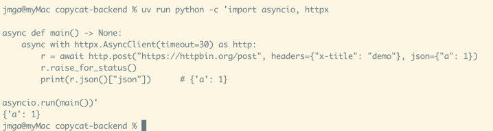
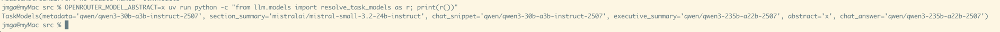
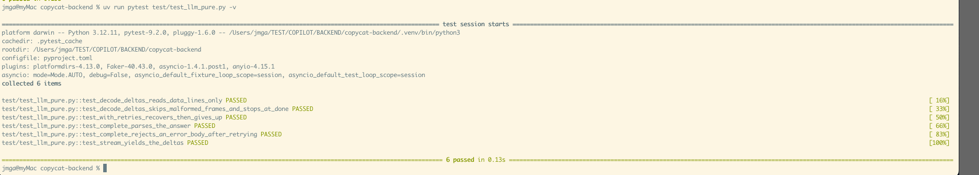
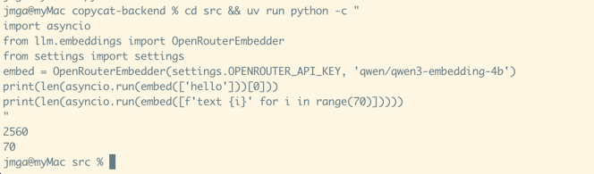
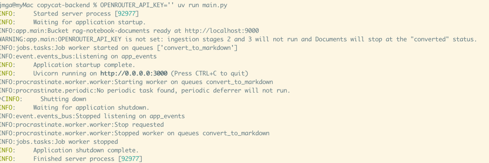
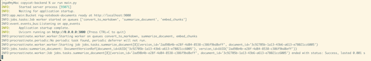
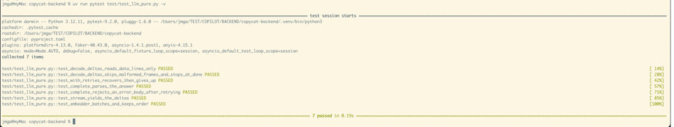

# T11 — OpenRouter clients: completion, streaming, embeddings

| Mode | Effort | Priority | Depends on | Unblocks | Learning value |
| --- | --- | --- | --- | --- | --- |
| Write | 1 day | P1 | T01 | T12, T13, T16 | Medium |

## Learning value

httpx streaming responses and decoding an OpenAI-compatible SSE body are new; the completion and embedding calls are plain POSTs with a retry loop.

## Why

Stage 2, stage 3 and chat all call OpenRouter. The model per task is server configuration only
(NBK-1: no user-facing model picker).

## What you need to know

### 1. `httpx.AsyncClient`

One client per process, reused for every request (it keeps connections open). `post(url,
headers=, json=)` sends JSON; `raise_for_status()` turns a 4xx or 5xx into an exception;
`.json()` parses the body. Set a timeout: model calls take tens of seconds.

```python
import asyncio, httpx


async def main() -> None:
    async with httpx.AsyncClient(timeout=30) as http:
        r = await http.post(
            "https://httpbin.org/post", headers={"x-title": "demo"}, json={"a": 1}
        )
        r.raise_for_status()
        print(r.json()["json"])  # {'a': 1}


asyncio.run(main())
```

Try it: `uv run python -c "..."` with the snippet above.




### 2. The chat completions request and response

OpenRouter speaks the OpenAI format. `POST /chat/completions` with `model`, `messages` (a
`system` and a `user` turn is all this app needs), optional `max_tokens` and `temperature`.
The answer text is at `choices[0].message.content`. An error can come back as a 200 with an
`error` key, so check for it.

```python
body = {
    "model": "qwen/qwen3-30b-a3b-instruct-2507",
    "temperature": 0.2,
    "max_tokens": 200,
    "messages": [
        {"role": "system", "content": "Answer in one word."},
        {"role": "user", "content": "Capital of France?"},
    ],
}
# response: {"choices": [{"message": {"role": "assistant", "content": "Paris"}}], "usage": {...}}
```

Headers: `authorization: Bearer <key>`, `content-type: application/json`, plus `http-referer`
and `x-title`, which OpenRouter uses to label the traffic in its dashboard.

### 3. Streaming: `text/event-stream` lines

With `"stream": true` the server answers a stream of lines. Only lines starting with `data:`
matter; each holds a JSON frame with a text delta at `choices[0].delta.content`, and the last
one is `data: [DONE]`. OpenRouter also sends comment lines such as `: OPENROUTER PROCESSING` as
keepalives, which you skip. In httpx, `client.stream(...)` gives a response whose
`aiter_lines()` yields the lines as they arrive.

```python
import json
from collections.abc import AsyncIterator


async def decode_deltas(lines: AsyncIterator[str]) -> AsyncIterator[str]:
    async for line in lines:
        if not line.startswith("data:"):
            continue
        payload = line[5:].strip()
        if payload == "[DONE]":
            return
        try:
            content = json.loads(payload)["choices"][0]["delta"].get("content")
        except (ValueError, KeyError, IndexError, TypeError):
            continue
        if content:
            yield content


async def fake_lines():
    for line in [
        ": OPENROUTER PROCESSING",
        'data: {"choices":[{"delta":{"content":"Pa"}}]}',
        'data: {"choices":[{"delta":{"content":"ris"}}]}',
        "data: [DONE]",
    ]:
        yield line


async def main():
    print([d async for d in decode_deltas(fake_lines())])  # ['Pa', 'ris']
```

An `async def` with `yield` is an async generator; you consume it with `async for`. The real
client wraps it: `async with http.stream("POST", url, headers=..., json=...) as r:
r.raise_for_status(); async for d in decode_deltas(r.aiter_lines()): yield d`.

### 4. A generic retry helper

Network calls fail for a moment and succeed a second later. One helper that takes a zero-argument
coroutine factory, retries it with a doubling delay, and re-raises the last error keeps every
client short. The `[T]` makes it generic so the return type flows through (Python 3.12 syntax).

```python
import asyncio
from collections.abc import Awaitable, Callable


async def with_retries[T](
    attempt: Callable[[], Awaitable[T]], *, retries: int, retry_delay_s: float
) -> T:
    for i in range(retries + 1):
        try:
            return await attempt()
        except Exception:
            if i == retries:
                raise
            await asyncio.sleep(retry_delay_s * 2**i)
    raise AssertionError("unreachable")


calls = 0


async def flaky() -> str:
    global calls
    calls += 1
    if calls < 3:
        raise ConnectionError("blip")
    return "ok"


print(asyncio.run(with_retries(flaky, retries=2, retry_delay_s=0.01)), calls)  # ok 3
```

Pass `lambda: self._complete(request)` or `functools.partial(self._embed_batch, batch)` as the
attempt, so each retry builds a fresh coroutine.

### 5. Embeddings and batching

`POST /embeddings` with `model` and `input` (a list of strings) answers `data: [{"embedding":
[...]}, ...]` in the same order. The model is `qwen/qwen3-embedding-4b` and each vector has
2560 numbers, the width of `chunks.embedding`. Send 32 texts per request: a long document has
hundreds of chunks and one request with all of them is rejected.

```python
texts = [f"chunk {i}" for i in range(70)]
batches = [texts[i : i + 32] for i in range(0, len(texts), 32)]
print([len(b) for b in batches])  # [32, 32, 6]
```

### 6. Callable types as seams

Everything downstream needs "something that completes a request" and "something that embeds
texts", not an HTTP client. Declare those as type aliases for callables; the real classes
implement `__call__` or a method, tests pass an `async def`.

```python
from collections.abc import Awaitable, Callable

ChatCompleter = Callable[[ChatCompletionRequest], Awaitable[str]]
Embedder = Callable[[list[str]], Awaitable[list[list[float]]]]


async def fake_complete(request: ChatCompletionRequest) -> str:  # a valid ChatCompleter
    return "Paris"
```

## What to build

**Files.** A new package `src/llm/` with three modules: `models.py` (which model does what), `openrouter.py` (completions and streaming), `embeddings.py` (vectors).\
One test file, `test/test_llm_pure.py`, with no database and no network.\
Step 4 touches `jobs/tasks.py` and `app/main.py`.

**Two seams, declared once and used everywhere downstream** (section 6):

```python
ChatCompleter = Callable[
    [ChatCompletionRequest], Awaitable[str]
]  # one request in, the answer text out
ChatStreamer = Callable[
    [ChatCompletionRequest], AsyncIterator[str]
]  # the same, as text deltas (T16 chat)
Embedder = Callable[
    [list[str]], Awaitable[list[list[float]]]
]  # texts in, one vector per text, same order
```

Stage 2 (T12) takes a `ChatCompleter`, Stage 3 (T13) an `Embedder`, chat (T16) a `ChatStreamer`.\
None of them ever sees an HTTP client, which is why their tests can pass an `async def`.

---

### Step 1. Dependency and `llm/models.py`

**Dependency.** `httpx` is only in the dev group so far (the test client). Make it a runtime dependency:

```sh
uv add httpx
```

**`llm/models.py`**, the whole file:

```python
from dataclasses import dataclass

from settings import settings


@dataclass(frozen=True)
class TaskModels:
    """Which OpenRouter model runs which generation task: server-side configuration only,
    never user-selectable (NBK-1)."""

    metadata: str = "qwen/qwen3-30b-a3b-instruct-2507"
    section_summary: str = "mistralai/mistral-small-3.2-24b-instruct"
    chat_snippet: str = "qwen/qwen3-30b-a3b-instruct-2507"
    executive_summary: str = "qwen/qwen3-235b-a22b-2507"
    abstract: str = "qwen/qwen3-30b-a3b-instruct-2507"
    chat_answer: str = "qwen/qwen3-235b-a22b-2507"


def resolve_task_models() -> TaskModels:
    """The defaults, each overridden by its OPENROUTER_MODEL_* setting when that is non-empty."""
    d = TaskModels()
    return TaskModels(
        metadata=settings.OPENROUTER_MODEL_METADATA or d.metadata,
        section_summary=settings.OPENROUTER_MODEL_SECTION_SUMMARY or d.section_summary,
        chat_snippet=settings.OPENROUTER_MODEL_CHAT_SNIPPET or d.chat_snippet,
        executive_summary=settings.OPENROUTER_MODEL_EXECUTIVE_SUMMARY
        or d.executive_summary,
        abstract=settings.OPENROUTER_MODEL_ABSTRACT or d.abstract,
        chat_answer=settings.OPENROUTER_MODEL_CHAT_ANSWER or d.chat_answer,
    )


# Welded to the database: `chunks.embedding` is declared this wide (migration 0007), so
# changing the embedding model is a migration (ADR-0002), not a setting.
DEFAULT_EMBEDDING_MODEL = "qwen/qwen3-embedding-4b"
EMBEDDING_DIMENSIONS = 2560


def resolve_embedding_model() -> str:
    return settings.OPENROUTER_MODEL_EMBEDDING or DEFAULT_EMBEDDING_MODEL
```

**What this module decides.** The backend calls an LLM for six different jobs: extracting
metadata, summarising a section, writing the chat snippet, the executive summary, the abstract,
and answering a chat question.\
Each job may use a different model, and the choice belongs to whoever runs the server, not to the user.\
`TaskModels` is the one place that choice lives: one field per job, each holding a model name.

**How a Stage uses it.** A Stage never writes a model name itself.\
It receives a `TaskModels` and reads the field for its job, for example `models.abstract` when writing the abstract.\
So changing the model for one job means changing one field here, and nothing in the Stages.

**Where the names come from.** Each field has a default in the dataclass, and `resolve_task_models()` builds the real
`TaskModels` at boot by looking at the six `OPENROUTER_MODEL_*` settings:

| `.env` line | resulting field |
| --- | --- |
| `OPENROUTER_MODEL_ABSTRACT=mistralai/mistral-small-3.2-24b-instruct` | `abstract` is that model |
| `OPENROUTER_MODEL_ABSTRACT=` (present but empty) | `abstract` is the default |
| line absent | pydantic refuses to start: the setting is declared required in `settings.py` |

The `or` in `settings.OPENROUTER_MODEL_ABSTRACT or d.abstract` is what makes the second row work: an empty string is false, so the default wins.

**The embedding model is different.** Every vector stored in `chunks.embedding` has 2560 numbers, because the column is declared that wide (migration 0007).\
Switching to a model with another vector size would make every stored vector unreadable, so that switch is a database migration, not a configuration change.\
That is why `EMBEDDING_DIMENSIONS` is a plain constant next to the default model name, and why `resolve_embedding_model()` only lets you pick a different model of the *same* width.

**DONE WHEN:** from `src/`, the override shows up and the other five stay at their defaults:

```sh
cd src && OPENROUTER_MODEL_ABSTRACT=x uv run python -c "from llm.models import resolve_task_models as r; print(r())"
```

prints `TaskModels(metadata='qwen/qwen3-30b-a3b-instruct-2507', ..., abstract='x', chat_answer='qwen/qwen3-235b-a22b-2507')`.



---

### Step 2. `llm/openrouter.py`: completions and streaming

**Add to the module**, top to bottom:

- `OPENROUTER_BASE_URL = "https://openrouter.ai/api/v1"`.
- `ChatCompletionRequest`, a frozen dataclass.
- The two aliases `ChatCompleter` and `ChatStreamer`.
- `with_retries`, exactly section 4's helper.
- `headers(api_key)`.
- `OpenRouterClient`.
- `STREAM_DONE = "[DONE]"` and `decode_deltas`, exactly section 3's function.

**The request.** A system instruction and one user turn is everything the pipeline needs:

```python
@dataclass(frozen=True)
class ChatCompletionRequest:
    model: str  # from TaskModels, never from a user
    system: str
    user: str
    max_output_tokens: int | None = None
    temperature: float = 0.2
```

**The headers.** OpenRouter attributes traffic by the last two; they make this app's spend identifiable in its dashboard:

```python
def headers(api_key: str) -> dict[str, str]:
    return {
        "authorization": f"Bearer {api_key}",
        "content-type": "application/json",
        "http-referer": "https://github.com/rag-notebook",
        "x-title": "RAG Notebook",
    }
```

**The client**, in full; the comments mark the four decisions:

```python
class OpenRouterClient:
    def __init__(
        self,
        api_key: str,
        *,
        base_url: str = OPENROUTER_BASE_URL,
        http: httpx.AsyncClient
        | None = None,  # (1) injectable, for httpx.MockTransport in tests
        retries: int = 2,
        retry_delay_s: float = 0.5,
        timeout_s: float = 120,  # model calls take tens of seconds
    ):
        self._url = f"{base_url.rstrip('/')}/chat/completions"
        self._headers = headers(api_key)
        self._http = http or httpx.AsyncClient(timeout=timeout_s)
        self._retries = retries
        self._retry_delay_s = retry_delay_s

    def _body(self, request: ChatCompletionRequest, stream: bool) -> dict:
        body: dict = {
            "model": request.model,
            "temperature": request.temperature,
            "messages": [
                {"role": "system", "content": request.system},
                {"role": "user", "content": request.user},
            ],
        }
        if request.max_output_tokens is not None:
            body["max_tokens"] = request.max_output_tokens
        if stream:
            body["stream"] = True
        return body

    async def _complete(self, request: ChatCompletionRequest) -> str:
        response = await self._http.post(
            self._url, headers=self._headers, json=self._body(request, stream=False)
        )
        response.raise_for_status()
        payload = response.json()
        if "error" in payload:  # (2) a 200 can still carry an error
            raise RuntimeError(
                f"OpenRouter error for model {request.model}: {payload['error']}"
            )
        text = payload["choices"][0]["message"]["content"]
        if not text or not text.strip():  # (2) ...or an empty answer
            raise RuntimeError(
                f"OpenRouter returned no content for model {request.model}."
            )
        return text

    async def complete(self, request: ChatCompletionRequest) -> str:
        return await with_retries(  # (3) retried: nothing was consumed yet
            lambda: self._complete(request),
            retries=self._retries,
            retry_delay_s=self._retry_delay_s,
        )

    async def stream(self, request: ChatCompletionRequest) -> AsyncIterator[str]:
        async with self._http.stream(  # (4) not retried: text may already be out
            "POST",
            self._url,
            headers={**self._headers, "accept": "text/event-stream"},
            json=self._body(request, stream=True),
        ) as response:
            response.raise_for_status()
            async for delta in decode_deltas(response.aiter_lines()):
                yield delta
```

The four decisions:

1. **The HTTP client is injectable.** Production passes nothing and gets one `AsyncClient` per `OpenRouterClient`, reused for every request.
   Tests pass `httpx.AsyncClient(transport=httpx.MockTransport(...))` and never touch the network.
2. **Two ways a 200 is still a failure.** OpenRouter may answer `200` with an `error` key, and a model may answer with empty content.
   Both raise `RuntimeError`, so the retry helper, and later the job queue, treat them like any other failure.
3. **`complete` retries, through `with_retries`.** The lambda builds a fresh coroutine for each attempt; a coroutine object cannot be awaited twice.
4. **`stream` does not retry.** Once a delta has been yielded to the caller, there is no clean way to start over.
   `decode_deltas` reads the `data:` lines and stops at `[DONE]`; `aiter_lines()` yields them as they arrive.

**DONE WHEN**, two parts. The pure tests of step 5:

```sh
uv run pytest test/test_llm_pure.py -q
```


And one real call each way, from `src/`, with the key from `.env` (this spends a fraction of a cent):

```sh
cd src && uv run python -c "
import asyncio
from llm.openrouter import OpenRouterClient, ChatCompletionRequest
from settings import settings
async def main():
    c = OpenRouterClient(settings.OPENROUTER_API_KEY)
    req = ChatCompletionRequest('qwen/qwen3-30b-a3b-instruct-2507', 'Answer in one word.', 'Capital of France?')
    print(await c.complete(req))
    async for d in c.stream(req): print(d, end='|')
    print()
asyncio.run(main())
"
```

prints `Paris`, then the same answer in streamed pieces such as `Par|is|`.\
Both calls sit inside one `asyncio.run`: an `httpx.AsyncClient` keeps its connections on the event loop that opened them, so a second `asyncio.run` with the same client fails with `Event loop is closed`.



---

### Step 3. `llm/embeddings.py`: vectors in batches

**Add to the module**: the `Embedder` alias, `DEFAULT_BATCH_SIZE = 32`, and `OpenRouterEmbedder`.

**Why batches.** `POST /embeddings` takes a list of texts and answers one vector per text, in order.\
A 200-page document is hundreds of chunks, and one request carrying all of them is rejected, so the texts go up 32 at a time.\
Batches run one after another, not concurrently: this is a background job and the API is rate limited.

**The class**, in full:

```python
class OpenRouterEmbedder:
    def __init__(
        self,
        api_key: str,
        model: str,  # bound here: there is exactly one embedding model
        *,
        base_url: str = OPENROUTER_BASE_URL,
        http: httpx.AsyncClient | None = None,
        retries: int = 2,
        retry_delay_s: float = 0.5,
        timeout_s: float = 120,
        batch_size: int = DEFAULT_BATCH_SIZE,
    ):
        self._url = f"{base_url.rstrip('/')}/embeddings"
        self._headers = headers(api_key)
        self._model = model
        self._http = http or httpx.AsyncClient(timeout=timeout_s)
        self._retries = retries
        self._retry_delay_s = retry_delay_s
        self._batch_size = max(1, batch_size)

    async def _embed_batch(self, batch: list[str]) -> list[list[float]]:
        response = await self._http.post(
            self._url,
            headers=self._headers,
            json={"model": self._model, "input": batch},
        )
        response.raise_for_status()
        payload = response.json()
        if "error" in payload:
            raise RuntimeError(
                f"OpenRouter error for embedding model {self._model}: {payload['error']}"
            )
        return [entry["embedding"] for entry in payload["data"]]

    async def __call__(
        self, texts: list[str]
    ) -> list[list[float]]:  # an instance is an Embedder
        vectors: list[list[float]] = []
        for start in range(0, len(texts), self._batch_size):
            batch = texts[start : start + self._batch_size]
            vectors.extend(
                await with_retries(
                    partial(self._embed_batch, batch),
                    retries=self._retries,
                    retry_delay_s=self._retry_delay_s,
                )
            )
        return vectors
```

`partial(self._embed_batch, batch)` plays the same role as the lambda in `complete`: a fresh coroutine per retry.\
`headers`, `with_retries` and `OPENROUTER_BASE_URL` are imported from `openrouter.py`.

**DONE WHEN:** from `src/`, with the key from `.env`: one vector of exactly 2560 floats, then 70 vectors sent as three requests (32, 32, 6; add a temporary `log.info` in `_embed_batch` to watch them):

```sh
cd src && uv run python -c "
import asyncio
from llm.embeddings import OpenRouterEmbedder
from settings import settings
embed = OpenRouterEmbedder(settings.OPENROUTER_API_KEY, 'qwen/qwen3-embedding-4b')
print(len(asyncio.run(embed(['hello']))[0]))
print(len(asyncio.run(embed([f'text {i}' for i in range(70)]))))
"
```

prints `2560` then `70`.




---

### Step 4. Wiring into the worker

**`jobs/tasks.py`.** Give `WorkerDeps` its real types and one more field:

```python
@dataclass
class WorkerDeps:
    storage: S3Storage
    convert_to_markdown: MarkdownConverter
    complete: ChatCompleter | None = None  # Stage 2 (T12)
    models: TaskModels | None = None  # which model per task, resolved once at boot
    embed: Embedder | None = None  # Stage 3 (T13)
```

`JobQueue.__init__` already works only the `summarize_document` queue when `complete` is set and `embed_chunks` when `embed` is set; nothing to change there.

**`app/main.py`**, in the lifespan, before `JobQueue` is built:

```python
api_key = settings.OPENROUTER_API_KEY
client = OpenRouterClient(api_key) if api_key else None
embed = OpenRouterEmbedder(api_key, resolve_embedding_model()) if api_key else None
jobs = JobQueue(
    WorkerDeps(
        storage=storage,
        convert_to_markdown=DoclingConverter(),
        complete=client.complete if client else None,
        models=resolve_task_models(),
        embed=embed,
    )
)
```

- The warning for a missing key is already there from T09 step 5.
- `client.stream` is not a worker dependency; T16 puts it on `app.state.chat`.
- One `OpenRouterEmbedder` for the whole process: Stage 3 and chat must embed with the same model, and this is where that is guaranteed.

**DONE WHEN**

- With `OPENROUTER_API_KEY=` empty, `uv run main.py` logs the T09 warning, `Job worker started on queues ['convert_to_markdown']`, and uploads still reach `converted`.



- With the key set, the boot line reads `Job worker started on queues ['convert_to_markdown', 'summarize_document', 'embed_chunks']`.
  The two extra queues have nothing to do until T12 and T13 give their tasks bodies.



---

### Step 5. Tests

**File:** `test/test_llm_pure.py`. No database, no network, no fixtures beyond `tmp_path` if you want one.

| test | what it does | asserts |
| --- | --- | --- |
| `test_decode_deltas_reads_data_lines_only` | feeds the four scripted lines of section 3 through `decode_deltas` | `["Pa", "ris"]` |
| `test_decode_deltas_skips_malformed_frames_and_stops_at_done` | lines: a `data: {` fragment, one good delta, `data: [DONE]`, then another good delta | only the first good delta comes out |
| `test_with_retries_recovers_then_gives_up` | a counter-based `flaky()` with `retry_delay_s=0` | returns after two failures with `retries=2`; raises the last error with `retries=1` |
| `test_complete_parses_the_answer` | `OpenRouterClient("k", http=httpx.AsyncClient(transport=httpx.MockTransport(handler)))` where `handler` returns `httpx.Response(200, json={"choices": [{"message": {"content": "Paris"}}]})` | `await client.complete(req) == "Paris"`; a second handler returning `{"error": {...}}` makes it raise `RuntimeError` |

`MockTransport` hands every request to your `handler(request) -> Response`, so the test can also inspect `request.headers["authorization"]` and the JSON body it sent.

**DONE WHEN**

```sh
uv run pytest test/test_llm_pure.py -q        # 4 passed, well under a second
```



## Acceptance

- A one-off script completes a prompt and embeds a sentence; the embedding has 2560 components.

## References

- Node: `apps/backend/src/llm/{openrouter,embeddings,models}.ts`.
