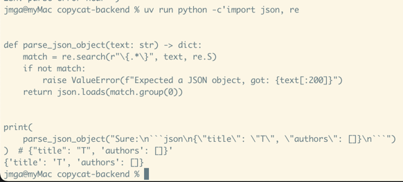
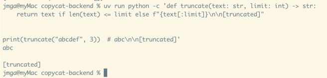
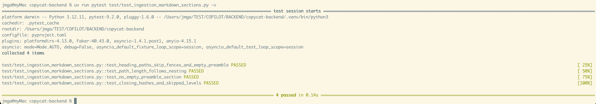
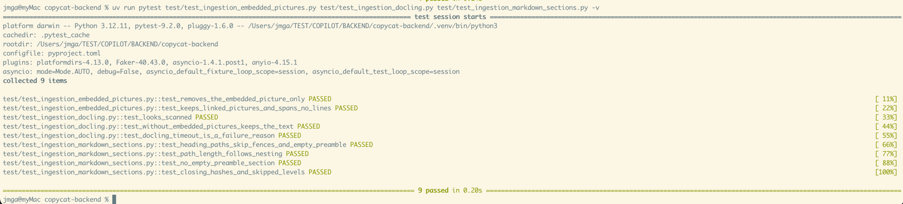
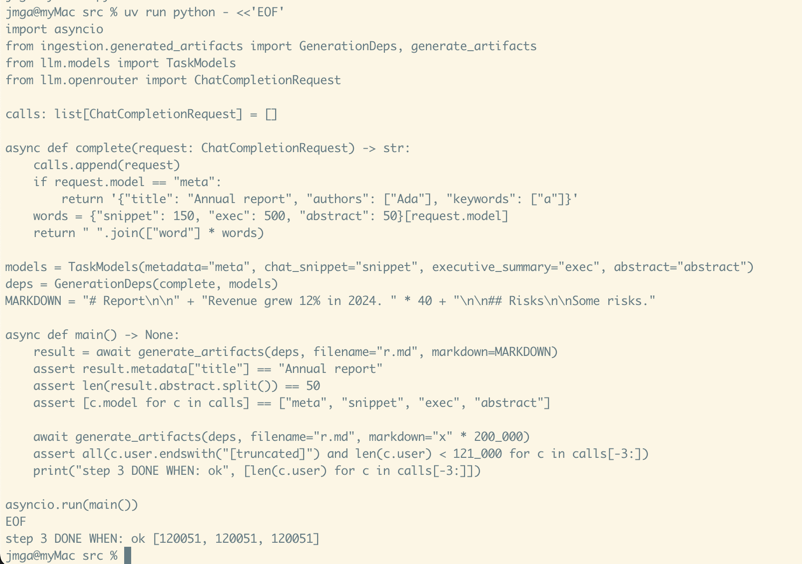
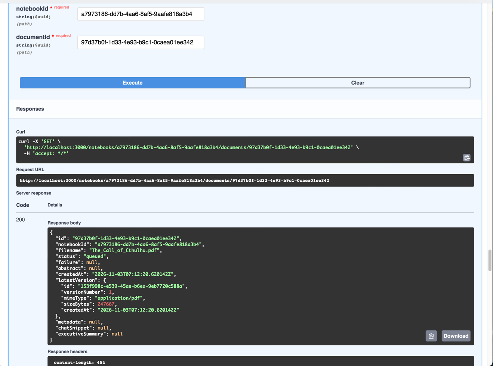
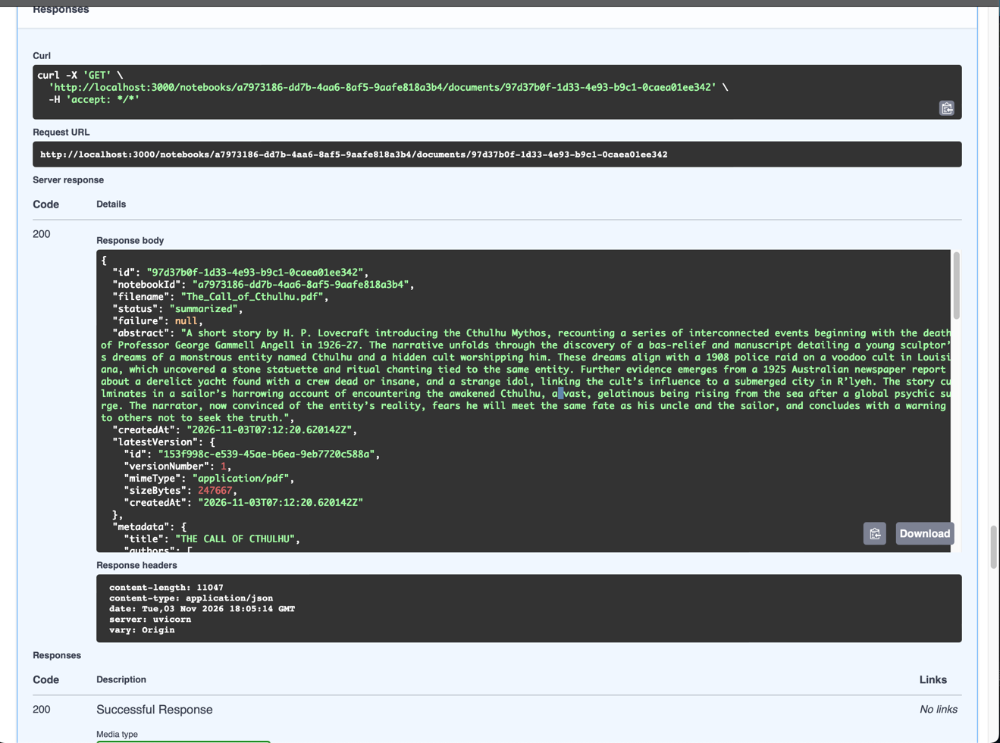
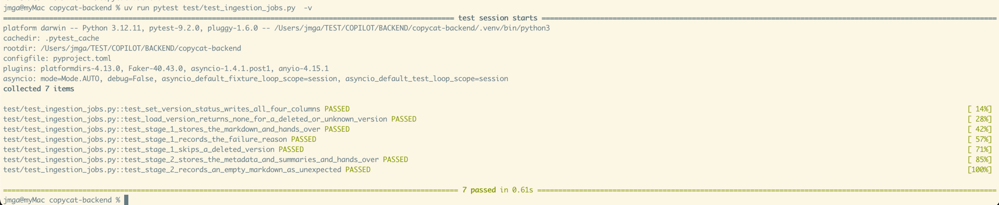

# T12 — Ingestion stage 2: metadata and the three summaries

| Mode  | Effort  | Priority | Depends on | Unblocks | Learning value |
| ----- | ------- | -------- | ---------- | -------- | -------------- |
| Write | 0.5 day | P2       | T10, T11   | T13      | Medium         |

## Learning value

Prompt design with JSON out, grounding rules (copy numbers verbatim), and a `dataclass` of injected
callables so the job is testable without a network. The map-reduce over sections has been dropped by
decision: documents whose Markdown does not fit the model's context are not summarized accurately,
they are truncated. That removes the most interesting part of the task but halves it.

## Why

Stage 2 extracts metadata and generates the Chat Snippet, Executive Summary and Abstract from the
Converted Markdown (NOTEBOOKS `docs/ingestion-summaries.md`). Each is one model call over the
Markdown, cut at a character budget. Anything past the budget is simply not seen by the model;
that is accepted.

## What you need to know

### 1. A prompt is a system instruction plus the text

The system message says what to produce, in what shape and length, and what not to do. The user
message carries the document. Two rules make the output usable: say "answer with the text only,
no preamble", and say "copy every number, unit and currency exactly as written". Without the
second one models quietly convert "3,140 km" to miles.

```python
req = ChatCompletionRequest(
    model=models.abstract,
    system="You write an Abstract: one short paragraph, 50 to 100 words, plain prose, no headings. "
    "Use only what the text states. Copy every number and unit exactly. Answer with the text only.",
    user=f"Document: {filename}\n\n{markdown}",
    max_output_tokens=400,
)
```

### 2. Getting JSON out of a model

Ask for "a single JSON object and nothing else" and give the schema in the prompt. Models still
wrap it in a code fence or add a sentence, so do not `json.loads` the raw answer: pull the
outermost braces out with a regex first. `re.S` makes `.` match newlines.

```python
import json, re


def parse_json_object(text: str) -> dict:
    match = re.search(r"\{.*\}", text, re.S)
    if not match:
        raise ValueError(f"Expected a JSON object, got: {text[:200]}")
    return json.loads(match.group(0))


print(
    parse_json_object('Sure:\n```json\n{"title": "T", "authors": []}\n```')
)  # {'title': 'T', 'authors': []}
```

Try it: `uv run python -c "..."` with the snippet. Then feed it `"no json here"` and see the
`ValueError`, which the job records as an `unexpected` failure.



### 3. Truncating to a character budget

Models have a context limit and OpenRouter rejects prompts past it. By decision, this stage cuts
the Markdown at a fixed number of characters and tells the model so. One helper, used by every
prompt.

```python
def truncate(text: str, limit: int) -> str:
    return text if len(text) <= limit else f"{text[:limit]}\n\n[truncated]"


print(truncate("abcdef", 3))  # abc\n\n[truncated]
```



A rough rule: four characters per token. 120,000 characters is about 30k tokens, within the
default models' windows with room for the answer.

### 4. A dataclass of injected callables

The generation code receives what it needs (a completer and the model names) as a small
dataclass. The job builds it from the real client; tests build it from a fake. No module-level
client, no patching.

```python
from dataclasses import dataclass


@dataclass
class GenerationDeps:
    complete: (
        ChatCompleter  # from T11: Callable[[ChatCompletionRequest], Awaitable[str]]
    )
    models: TaskModels


async def generate_abstract(deps: GenerationDeps, markdown: str) -> str:
    return (
        await deps.complete(
            ChatCompletionRequest(deps.models.abstract, "...", markdown)
        )
    ).strip()
```

### 5. A scripted fake completer in tests

A fake that answers by model name lets one test check the whole stage: which calls were made, in
which order, and what got stored. Give each task a distinct fake model name so the answers are
easy to tell apart.

```python
calls: list[ChatCompletionRequest] = []


async def complete(request: ChatCompletionRequest) -> str:
    calls.append(request)
    if request.model == "meta":
        return '{"title": "Annual report", "authors": ["Ada"], "keywords": ["a"]}'
    words = {"snippet": 150, "exec": 500, "abstract": 50}[request.model]
    return " ".join(["word"] * words)


models = TaskModels(
    metadata="meta",
    chat_snippet="snippet",
    executive_summary="exec",
    abstract="abstract",
)
```

### 6. JSONB from Python

`document_versions.metadata` is JSONB. Pass `json.dumps(dict)` as the bound parameter in the
UPDATE; asyncpg hands the string to Postgres, which parses it. Reading it back through
SQLAlchemy gives you a `dict` again.

## What to build

Five steps. Steps 1 and 2 are small pure helpers, step 3 is the generation code, step 4 is the
job around it, step 5 is the test. Each step says what it is for, then what to write, then how
you know it is done.

### Step 1. Split the Markdown into sections

**File:** `ingestion/markdown_sections.py`

```python
@dataclass
class MarkdownSection:
    heading_path: list[str]  # enclosing headings, outermost first, including its own
    heading: str | None  # None for the text before the first heading
    level: int  # 1 to 6, or 0 for the preamble
    content: str  # the body under the heading, without the heading line


def split_markdown_sections(markdown: str) -> list[MarkdownSection]: ...
```

Walk the lines and:

- track whether you are inside a fenced block: a line starting with `` ``` `` or `~~~` toggles it;
- outside fences, match ATX headings with `^(#{1,6})\s+(.*?)\s*#*\s*$`;
- flush the current section on each heading;
- keep a list of open headings indexed by level: a level-2 heading cuts the list at index 1
  and appends.

The text before the first heading is a section only if it has content. A heading with no body
still yields a section.

```python
sections = split_markdown_sections(
    "Preamble\n\n# Report\n\n## Risks\n\ntext\n\n```\n# not a heading\n```\n"
)
assert [s.heading_path for s in sections] == [[], ["Report"], ["Report", "Risks"]]
```

Stage 2 only needs the heading outline from this; T13's chunking is the real user. Build it in
whichever task you reach first.

**DONE WHEN:** the assertion above passes as a unit test, and a document with `#`, `##`, `###`
then `##` gives paths of length 1, 2, 3, 2.




### Step 2. Drop embedded pictures

**File:** `ingestion/embedded_pictures.py`

Docling embeds pictures on one line as ``. The model reads
text; a base64 picture is thousands of useless characters of budget. One regex, one function:

```python
EMBEDDED_PICTURE = re.compile(r"!\[[^\]\n]*\]\(data:[^)\s]*\)")


def without_embedded_pictures(markdown: str) -> str:
    return EMBEDDED_PICTURE.sub("", markdown)
```

**DONE WHEN:**

```python
assert without_embedded_pictures("a  b") == "a  b"
```



### Step 3. Generate the metadata and the three texts

**File:** `ingestion/generated_artifacts.py`

Everything here is pure: it takes a completer and model names, and returns text. No database,
no queue.

#### 3a. Constants and helpers

```python
# name -> (min words, max words, brief)
ARTIFACT_BRIEFS: dict[str, tuple[int, int, str]] = {
    "chat_snippet": (150, 300, "..."),
    "executive_summary": (500, 1000, "..."),
    "abstract": (50, 100, "..."),
}

METADATA_CHAR_BUDGET = 12_000
ARTIFACT_CHAR_BUDGET = 120_000  # lower it if a model rejects the prompt
```

- Take the three briefs and word ranges from `apps/backend/src/ingestion/generated-artifacts.ts`.
- `truncate(text, limit)` and `parse_json_object(text)` are the two functions from the tutorial
  above.

#### 3b. The two dataclasses

```python
@dataclass
class GenerationDeps:
    complete: ChatCompleter  # T11: Callable[[ChatCompletionRequest], Awaitable[str]]
    models: TaskModels


@dataclass
class GenerationResult:
    metadata: dict
    chat_snippet: str
    executive_summary: str
    abstract: str
```

#### 3c. `extract_metadata`

```python
async def extract_metadata(
    deps: GenerationDeps,
    *,
    filename: str,
    markdown: str,
    sections: list[MarkdownSection],
) -> dict: ...
```

One call on `deps.models.metadata`, then `return parse_json_object(answer)`.

The **system** message asks for a single JSON object with this schema:

```json
{
  "title": "string | null",
  "authors": ["string"],
  "documentType": "string | null",
  "language": "string | null",
  "publishedOn": "string | null",
  "subject": "string | null",
  "keywords": ["string"]
}
```

and adds three rules: at most 10 keywords; `null` when the document does not state it; never
infer an author from the filename.

The **user** message carries, in this order:

1. the filename;
2. the heading outline: one line per section, indented by level, first 80 headings only;
3. `truncate(markdown, METADATA_CHAR_BUDGET)`.

#### 3d. `generate_artifact`

```python
async def generate_artifact(
    deps: GenerationDeps, name: str, *, filename: str, metadata: dict, markdown: str
) -> str: ...
```

One call on `getattr(deps.models, name)`, with `min_words, max_words, brief =
ARTIFACT_BRIEFS[name]`. Return the stripped answer.

The **system** message is three sentences:

```text
You write {brief}
Use only what the text below states. Do not add facts. Copy every number, unit and currency exactly as given.
Length: between {min_words} and {max_words} words. Answer with the text only.
```

The **user** message is a short header, then the text:

```text
Document: <metadata title, or the filename>
Type: <documentType, only when known>
Authors: <authors joined, only when known>

<truncate(markdown, ARTIFACT_CHAR_BUDGET)>
```

Set `max_output_tokens = max_words * 2 + 200`.

#### 3e. `generate_artifacts`

```python
async def generate_artifacts(
    deps: GenerationDeps, *, filename: str, markdown: str
) -> GenerationResult: ...
```

In order:

1. `sections = split_markdown_sections(markdown)`;
2. `metadata = await extract_metadata(...)`;
3. `texts = {name: await generate_artifact(deps, name, ...) for name in ARTIFACT_BRIEFS}`;
4. `return GenerationResult(metadata, **texts)`.

Four model calls in total: metadata, chat snippet, executive summary, abstract.

Skip the Node extras on purpose: no section summaries, no corrective rewrite, no trimming, no
warnings, no resumable cache.

**DONE WHEN:** with the scripted completer of the tutorial, these hold:

```python
result = await generate_artifacts(deps, filename="r.md", markdown=MARKDOWN)
assert result.metadata["title"] == "Annual report"
assert len(result.abstract.split()) == 50
assert [c.model for c in calls] == ["meta", "snippet", "exec", "abstract"]
```

and with a 200,000-character Markdown, the user prompt of the three artifact calls ends with
`[truncated]` and is shorter than 121,000 characters:

```python
await generate_artifacts(deps, filename="r.md", markdown="x" * 200_000)
assert all(c.user.endswith("[truncated]") and len(c.user) < 121_000 for c in calls[-3:])
```




### Step 4. The job

**File:** `ingestion/summarize_document.py`

```python
SUMMARIZE_DOCUMENT_QUEUE = "summarize-document"


@dataclass
class SummarizeDocumentDeps:
    db: AsyncSession
    complete: ChatCompleter
    models: TaskModels | None = None
    enqueue_embed_chunks: Callable[[DocumentVersionRef], Awaitable[None]] | None = None


async def run_summarize_document_job(
    deps: SummarizeDocumentDeps, ref: DocumentVersionRef
) -> None: ...
```

Same shape as T10's job:

1. `row = await load_version(db, ref, "markdown")`; return if `None`.
2. `set_version_status(..., "summarizing")`.
3. In a `try`:
   - raise `RuntimeError` if the Markdown is empty;
   - `result = await generate_artifacts(GenerationDeps(deps.complete, deps.models or
     resolve_task_models()), filename=row.filename,
     markdown=without_embedded_pictures(row.markdown))`;
   - `set_version_status(..., "summarized", metadata=json.dumps(result.metadata),
     chat_snippet=..., executive_summary=..., abstract=..., summarized_at=datetime.now(UTC))`;
   - then `await deps.enqueue_embed_chunks(ref)` if it is set.
4. `except Exception as err`: rollback, `set_version_status(..., "failed", error=err,
   failed_at="summarizing")`, re-raise.

Wire the procrastinate task in T09's `jobs/tasks.py` (three lines, like stage 1), registered only
when the worker has a completer.

**DONE WHEN:** the test of step 5 passes, and `GET /notebooks/{nb}/documents/{id}` after a real
run shows `abstract`, `executiveSummary` and `metadata.title` filled.

_start ingestion_




_ingestion completed_



### Step 5. Test

**File:** `test/test_ingestion_jobs.py`

**Happy path.** Seed a `converted` version with this Markdown:

```python
"# Report\n\n" + "Revenue grew 12% in 2024. " * 40 + "\n\n## Risks\n\nSome risks."
```

Run the job with the scripted completer and the fake `TaskModels` from the tutorial, then assert:

- the status is `summarized`;
- `metadata["title"] == "Annual report"`, read back from the row as a `dict`;
- `len(abstract.split()) == 50`;
- exactly four calls, in the order metadata, snippet, exec, abstract.

**Empty Markdown.** Seed a version with `markdown=None` and expect `RuntimeError`, and
`("failed", "unexpected", "summarizing")` on the row.

**DONE WHEN:** the job tests are green:

```sh
uv run pytest test/test_ingestion_jobs.py -q
```


## Acceptance

- With a real key, an uploaded document reaches `summarized` and `GET .../documents/{id}` shows a
  non-null Abstract and Executive Summary.
- A document longer than the budget still reaches `summarized`; its summaries only cover the start.

## References

- Node: `apps/backend/src/ingestion/{markdown-sections,embedded-pictures,generated-artifacts,summarize-document}.ts`.
