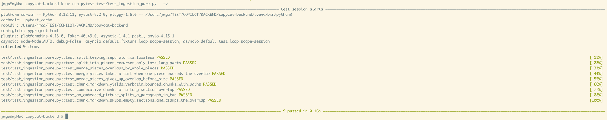
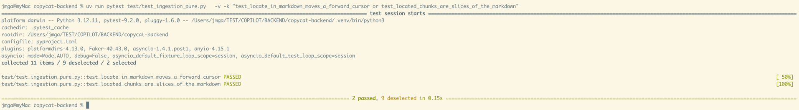
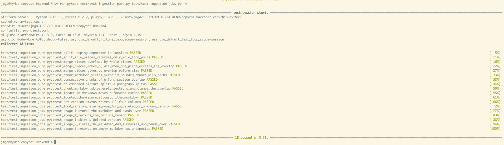

# T13 — Ingestion stage 3: chunking and embeddings

| Mode | Effort | Priority | Depends on | Unblocks | Learning value |
| --- | --- | --- | --- | --- | --- |
| Write | 1 day | P2 | T12 | T16 | High |

## Learning value

The recursive text splitter with overlap is a classic worth implementing once; pgvector inserts and the stored-range trick (`chunk_ranges`) complete the retrieval side.

## Why

Stage 3 makes a Version searchable: it splits the Markdown into Chunks, embeds them, stores both
and moves the Version to `ready`, the only status chat may rely on.

## What you need to know

### 1. Why chunks must be verbatim slices

A Citation points at a Chunk, and the frontend highlights that passage in the Markdown it shows.
That only works if the chunk text is a contiguous, unchanged slice of the Markdown. So the
splitter never normalises whitespace, and every separator it splits on stays attached to the
piece before it, so joining the pieces gives the input back.

```python
def split_keeping_separator(text: str, separator: str) -> list[str]:
    if separator == "":
        return [text]
    parts, start = [], 0
    while (at := text.find(separator, start)) != -1:
        parts.append(text[start : at + len(separator)])
        start = at + len(separator)
    if start < len(text):
        parts.append(text[start:])
    return parts


parts = split_keeping_separator("a. b. c", ". ")
print(parts, "".join(parts) == "a. b. c")  # ['a. ', 'b. ', 'c'] True
```

### 2. Recursive character splitting

Try the strongest separator first (a blank line), and only for pieces still longer than
`chunk_size` recurse with the next one (newline, sentence end, space), down to a hard cut. This
is what LangChain's `RecursiveCharacterTextSplitter` does.

```python
SEPARATORS = ["\n\n", "\n", ". ", " ", ""]


def split_into_pieces(text: str, chunk_size: int, separators: list[str]) -> list[str]:
    if not separators or separators[0] == "":
        return [text[i : i + chunk_size] for i in range(0, len(text), chunk_size)]
    sep, rest = separators[0], separators[1:]
    pieces = []
    for part in split_keeping_separator(text, sep):
        if part == "":
            continue
        pieces.append(part) if len(part) <= chunk_size else pieces.extend(
            split_into_pieces(part, chunk_size, rest)
        )
    return pieces


print(split_into_pieces("one two three\n\nfour five", 8, SEPARATORS))
# ['one ', 'two ', 'three\n', '\n', 'four ', 'five']  (the blank line is a piece of its own)
```

### 3. Merging pieces into chunks with overlap

Pieces are small. Greedily append them to a buffer until the next one would exceed
`chunk_size`, emit the buffer as a chunk, then start the next buffer with the last pieces of
the previous one up to `chunk_overlap` characters. Overlap keeps a sentence cut in two
retrievable from both sides.

```python
def merge_pieces(pieces, chunk_size, chunk_overlap):
    chunks, buffer, length = [], [], 0
    for piece in pieces:
        if length and length + len(piece) > chunk_size:
            chunks.append("".join(buffer))
            kept = []
            while buffer and sum(map(len, kept)) + len(buffer[-1]) <= chunk_overlap:
                kept.insert(0, buffer.pop())
            buffer, length = kept, sum(map(len, kept))
        buffer.append(piece)
        length += len(piece)
    if buffer:
        chunks.append("".join(buffer))
    return chunks


print(merge_pieces(["one ", "two ", "three\n\n", "four ", "five"], 10, 4))
# ['one two ', 'two three\n\n', 'four five']
```

This toy version ignores two edge cases the real one must handle: a single piece longer than
the overlap (take its tail), and an overlap plus a piece exceeding `chunk_size` (give up overlap,
never size). Port `chunking.ts` for those.

### 4. Where a chunk sits: `chunk_ranges`

Search and Citations need the character offsets of each chunk in the Markdown. Because chunks
are verbatim and in order, `str.find` with a forward-moving cursor finds them. Move the cursor by
one character, not to the end of the match, because consecutive chunks overlap.

```python
def locate_in_markdown(markdown: str, texts: list[str]) -> list[tuple[int, int] | None]:
    cursor, ranges = 0, []
    for t in texts:
        at = markdown.find(t, cursor)
        if at == -1:
            ranges.append(None)
            continue
        cursor = at + 1
        ranges.append((at, at + len(t)))
    return ranges


md = "alpha beta gamma"
print(locate_in_markdown(md, ["alpha beta", "beta gamma"]))  # [(0, 10), (6, 16)]
```

### 5. Inserting a pgvector value

pgvector's text form is `[0.1,0.2,...]` (square brackets, not a Postgres array). Bind it as a
string and cast: `CAST(:embedding AS vector)`. A `TEXT[]` column takes a Python list through
asyncpg with `CAST(:heading_path AS text[])`.

```python
def to_vector_literal(vector: list[float]) -> str:
    return "[" + ",".join(repr(x) for x in vector) + "]"


await db.execute(
    text(
        "INSERT INTO chunks (document_version_id, chunk_index, heading_path, text, embedding)"
        " VALUES (:v, :i, CAST(:hp AS text[]), :t, CAST(:e AS vector)) RETURNING id"
    ),
    {
        "v": version_id,
        "i": 0,
        "hp": ["Report", "Risks"],
        "t": "...",
        "e": to_vector_literal(vector),
    },
)
```

The column is `vector(2560)`: a vector of any other length is rejected by Postgres, which is
your check that the embedding model is the right one.

### 6. Delete then insert, in one transaction

A retry may produce fewer chunks than the attempt before. Deleting the Version's chunks and
inserting the new set in the same transaction means a reader never sees a mix. `chunk_ranges`
rows go with `ON DELETE CASCADE`, and the `AFTER INSERT` trigger of migration 0016 fills
`notebook_words` for the search typo correction without any code here.

## What to build

Four steps. Step 1 is the splitter, step 2 the range finder, step 3 the job that embeds and
stores, step 4 the tests. Each step says what it is for, then what to write, then how you know
it is done.

### Step 1. Split the Markdown into chunks

**File:** `ingestion/chunking.py`

```python
@dataclass(frozen=True)
class DocumentChunk:
    index: int
    heading_path: list[str]  # the section's path, from T12's split_markdown_sections
    text: str  # a verbatim slice of the Markdown


def chunk_markdown(
    markdown: str, chunk_size: int = 1000, chunk_overlap: int = 150
) -> list[DocumentChunk]: ...
```

#### 1a. The three splitter functions

`split_keeping_separator`, `split_into_pieces` and `merge_pieces` as in the tutorial, plus the
two edge cases of `chunking.ts` in `merge_pieces`:

- **No whole piece fits the overlap.** Keep the tail of the last piece instead:
  `buffer[-1][-chunk_overlap:]`.
- **The carried overlap plus the next piece exceeds `chunk_size`.** Drop pieces from the front of
  the buffer, and cut the last one, until it fits. Overlap gives way; size never does.

#### 1b. `chunk_markdown`

1. Clamp `chunk_overlap` to `chunk_size - 1`.
2. For each section of T12's `split_markdown_sections(markdown)`:
   - split its content on embedded pictures: `EMBEDDED_PICTURE.split(section.content)`;
   - strip each stretch; skip it when empty or when it has no word character (a picture in a
     list item leaves its bullet behind);
   - `merge_pieces(split_into_pieces(stretch, chunk_size, SEPARATORS), chunk_size, chunk_overlap)`;
   - strip each resulting chunk and append
     `DocumentChunk(len(chunks), section.heading_path, text)`.

```python
markdown = (
    "# A\n\n" + "para one. " * 30 + "\n\n" + "para two. " * 30 + "\n\n# B\n\nshort"
)
chunks = chunk_markdown(markdown, chunk_size=200, chunk_overlap=20)
assert all(c.text in markdown for c in chunks)
assert all(len(c.text) <= 200 for c in chunks)
assert chunks[-1].heading_path == ["B"] and chunks[-1].text == "short"
```

**DONE WHEN:** the assertions above pass as a unit test, consecutive chunks of the long section
share text (the overlap), and an embedded picture splits a paragraph into two chunks:

```python
chunks = chunk_markdown("# A\n\nbefore  after")
assert [c.text for c in chunks] == ["before", "after"]
```



### Step 2. Find where each chunk sits

**File:** `document/chunk_ranges.py`

It lives in `document/`, not `ingestion/`, because T16's Citations read the same ranges.

```python
@dataclass(frozen=True)
class ChunkRange:
    char_start: int
    char_end: int


def locate_in_markdown(markdown: str, texts: list[str]) -> list[ChunkRange | None]: ...
```

The forward-cursor search of the tutorial, one result per text in chunk order, `None` when a
text is not found.

**DONE WHEN:**

```python
assert locate_in_markdown("alpha beta gamma", ["alpha beta", "beta gamma", "zzz"]) == [
    ChunkRange(0, 10),
    ChunkRange(6, 16),
    None,
]
```




### Step 3. The job

**File:** `ingestion/embed_chunks.py`

```python
EMBED_CHUNKS_QUEUE = "embed-chunks"


@dataclass
class EmbedChunksDeps:
    db: AsyncSession
    embed: Embedder  # T11: Callable[[list[str]], Awaitable[list[list[float]]]]
    chunk_size: int = 1000
    chunk_overlap: int = 150


def to_vector_literal(vector: list[float]) -> str: ...  # tutorial step 5


async def replace_chunks(
    db: AsyncSession,
    version_id: uuid.UUID,
    markdown: str,
    chunks: list[DocumentChunk],
    vectors: list[list[float]],
) -> None: ...


async def run_embed_chunks_job(
    deps: EmbedChunksDeps, ref: DocumentVersionRef
) -> None: ...
```

#### 3a. `replace_chunks`

No commit here: the job's final `set_version_status` commits everything at once.

1. Delete the previous set:

   ```sql
   DELETE FROM chunks WHERE document_version_id = :id
   ```

2. Locate the new set: `ranges = locate_in_markdown(markdown, [c.text for c in chunks])`.
3. For each `(chunk, vector, located)` in `zip(chunks, vectors, ranges, strict=True)`:
   - insert the chunk with the statement of tutorial step 5, `RETURNING id`;
   - when `located` is not `None`:

     ```sql
     INSERT INTO chunk_ranges (chunk_id, char_start, char_end) VALUES (:chunk_id, :start, :end)
     ```

#### 3b. `run_embed_chunks_job`

Same shape as stages 1 and 2:

1. `row = await load_version(db, ref, "markdown")`; return if `None`.
2. `set_version_status(..., "indexing")`.
3. In a `try`:
   - raise `RuntimeError` if the Markdown is empty;
   - `chunks = chunk_markdown(row.markdown, deps.chunk_size, deps.chunk_overlap)`;
   - `vectors = await deps.embed([c.text for c in chunks])`;
   - `await replace_chunks(db, ref.version_id, row.markdown, chunks, vectors)`;
   - `set_version_status(..., "ready", embedded_at=now, chunk_ranges_located_at=now)`. This
     commit covers the inserts above.
4. `except Exception as err`: rollback, `set_version_status(..., "failed", error=err,
   failed_at="indexing")`, re-raise.

Wire the procrastinate task in `jobs/tasks.py` (three lines, like stages 1 and 2), registered
only when the worker has an embedder.

**DONE WHEN:** the two tests of step 4 pass, and with a real key an uploaded Document reaches
`ready` and the chunk count grows:

```sql
SELECT count(*) FROM chunks;
```

### Step 4. Tests

**Pure, in `test/test_ingestion_pure.py`:** the chunking assertions of step 1 and the
`locate_in_markdown` case of step 2.

**With the database, in `test/test_ingestion_jobs.py`:**

*Happy path.* Seed a `summarized` version with the T12 test Markdown and run the job with a
fake embedder:

```python
async def embed(texts: list[str]) -> list[list[float]]:
    return [[0.0] * EMBEDDING_DIMENSIONS for _ in texts]
```

Then assert:

- the status is `ready`;
- every chunk is where its range says. Read the rows with

  ```sql
  SELECT c.text, r.char_start
  FROM chunks c JOIN chunk_ranges r ON r.chunk_id = c.id
  WHERE c.document_version_id = :v
  ORDER BY c.chunk_index
  ```

  and check `MARKDOWN[char_start:].startswith(text)` for each;
- the trigger ran: `SELECT count(*) FROM notebook_words WHERE word = 'revenue'` is 1.

*Empty Markdown.* Seed a version with `markdown=None` and expect `RuntimeError`, and
`("failed", "unexpected", "indexing")` on the row.

**DONE WHEN:** the pure and job tests are green:

```sh
uv run pytest test/test_ingestion_pure.py test/test_ingestion_jobs.py -q
```



## Acceptance

- With a real key, a Document reaches `ready`; `SELECT count(*) FROM chunks` grows; `notebook_words`
  contains the document's words.

## References

- Node: `apps/backend/src/ingestion/{chunking,embed-chunks}.ts`, `documents/chunk-ranges.ts`; `docs/ingestion-embeddings.md`.
