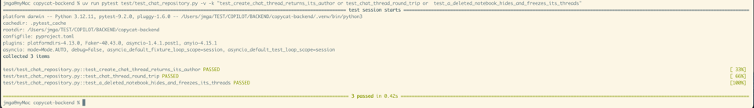
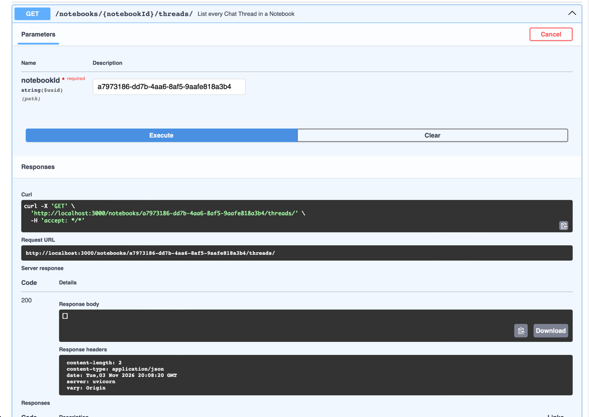
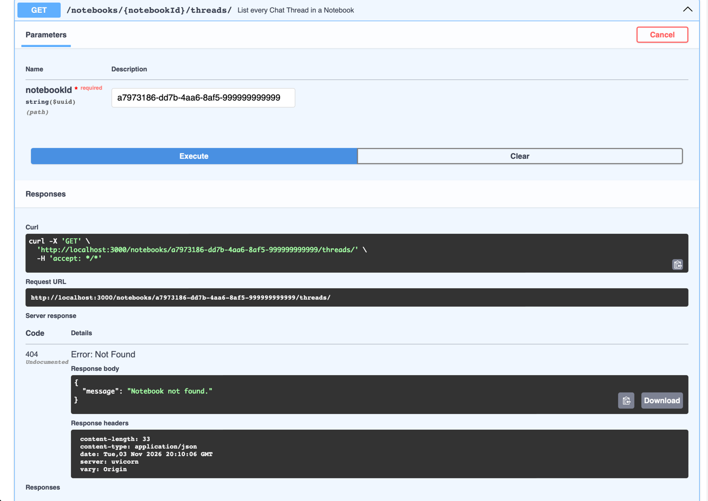
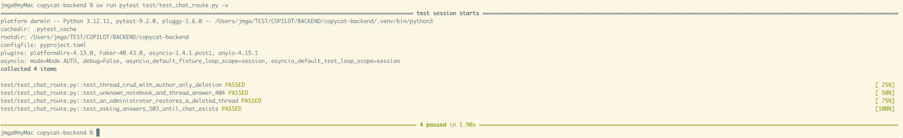

# T15 — Chat Threads: CRUD, messages, Administrator restore

| Mode | Effort | Priority | Depends on | Unblocks | Learning value |
| --- | --- | --- | --- | --- | --- |
| Copy | 0.25 day | P1 | T02, T04 | T16 | Low |

## Why this is a copy

Six CRUD operations identical in shape to T04 and T08. T16 needs this feature to exist, not to be
hand-written. The two pieces T16 builds on, `SELECT_CITATIONS` and `append_question_and_answer`,
are read carefully rather than rewritten.

## Why

Six of the seven chat operations are plain CRUD over `chat_threads` and `chat_messages`; they
work without any LLM and are what the frontend's chat panel loads first. `chat_router.py` is stubs.

## What you need to know

### 1. The Citations join pins the past, not the present

A Citation stores `document_version_id` and `chunk_id`. The join reads `filename`, `version_number`
and `heading_path` off that pinned Version and chunk, and deliberately does not filter
`deleted_at`: a Document deleted last week still explains an answer given two weeks ago.

```sql
SELECT ci.id, ci.chat_message_id, ci.marker, v.document_id, ci.document_version_id,
       v.version_number, ci.chunk_id, d.filename, c.heading_path, ci.char_start, ci.char_end
FROM citations ci
JOIN chunks c ON c.id = ci.chunk_id
JOIN document_versions v ON v.id = ci.document_version_id
JOIN documents d ON d.id = v.document_id
WHERE ci.chat_message_id = ANY(CAST(:ids AS uuid[]))
ORDER BY ci.chat_message_id, ci.marker
```

`ANY(CAST(:ids AS uuid[]))` takes a Python `list[uuid.UUID]` as one bound parameter, so the
citations of a whole Thread come back in one query and are grouped by `chat_message_id` in Python.

### 2. One transaction for an exchange

`append_question_and_answer` runs two `INSERT ... RETURNING` for the question and the answer,
then one `INSERT` per Citation, and commits once at the end. If anything fails nothing is
written. `chat_messages.seq` is a database sequence, so the question gets a lower `seq` than its
answer even though both rows share a `created_at`. That is why messages are listed `ORDER BY seq`.

```python
question_row = (await db.execute(text(INSERT_MESSAGE), {**base, "role": "user", "content": question})).one()
answer_row = (await db.execute(text(INSERT_MESSAGE), {**base, "role": "assistant", "content": answer})).one()
for citation in citations:
    await db.execute(text(INSERT_CITATION), {"message_id": answer_row.id, ...})
await db.commit()
```

Try it: insert a question and an answer by hand and check `SELECT role, seq FROM chat_messages ORDER BY seq`.

### 3. Author and Administrator rules live in the router

Anyone may read, rename and continue a Thread. Only its author may delete it. Only an
Administrator, a user whose email is listed in `ADMIN_EMAILS`, may restore one.
`settings.administrators` is a lower-cased set built from that comma-separated variable.

```python
if thread.author.id != user.id:
    raise HTTPException(403, "Only the user who started a Chat Thread may delete it.")

if user.email.lower() not in settings.administrators:
    raise HTTPException(403, "Only an Administrator may restore a Chat Thread.")
```

### 4. 404 before 403

Look the Thread up first (scoped to a live Notebook, `deleted_at IS NULL`) and answer 404 when it
is missing; only then check who is asking. Restore is the exception: it answers 403 to a
non-Administrator before looking anything up, and 404 when there is no deleted Thread by that id.
Error detail is a plain string; T01's handler turns it into `{"message": "..."}`.

## What to copy

Five steps: the DTOs, the repository, the router, the entities to delete, and one test file.
Every file comes from `BACKEND/reference-backend/src/chat/`; each step says what to copy, what
to change after copying, and how you know it is done.

### Step 1. DTOs

**Copy** `reference-backend/src/chat/chat_dto.py` **over** `src/chat/chat_dto.py`.

It defines eight models, all with `serialization_alias` for the camelCase keys:

| Model | Used by |
| --- | --- |
| `ChatParticipant` | who did something: `id` and `email` |
| `ChatThreadResponse` | list, create, rename, restore |
| `CreateChatThreadBody`, `RenameChatThreadBody` | the two request bodies with a `title` |
| `CitationResponse` | one pointer into a pinned Document Version and chunk |
| `ChatMessageResponse` | one message, with its `askedBy` and `citations` |
| `SendChatMessageBody`, `SendChatMessageResponse` | T16's question and answer |

The old stub had three thread response models (`Create...`, `Rename...`, `Restore...`); the
reference folds them into `ChatThreadResponse`. Until step 3 replaces the router, point the stub's
imports at that name so the app still starts.

**DONE WHEN:** run from `src/`, the command prints `askedBy`:

```sh
uv run python -c "from chat.chat_dto import ChatMessageResponse; print(ChatMessageResponse.model_fields['asked_by'].serialization_alias)"
```


### Step 2. Repository

**Copy** `reference-backend/src/chat/chat_repository.py` **to** `src/chat/chat_repository.py`.

It imports four things. Two exist here, two need work:

| Import | Here |
| --- | --- |
| `db.get_db`, `db.rowcount` | exist, keep |
| `notebook.active_notebooks.notebook_is_active` | does not exist (T04 step 1): drop it |
| `.citations.ResolvedCitation` | does not exist until T16: create a stub now |

**Replace the SQL helper.** Every `{notebook_is_active('t.notebook_id')}` in the copied SQL
becomes a plain join:

```sql
JOIN notebooks n ON n.id = t.notebook_id AND n.deleted_at IS NULL
```

**Create `src/chat/citations.py`** with only the frozen dataclass. T16 fills the module in:

```python
from dataclasses import dataclass


@dataclass(frozen=True)
class ResolvedCitation:
    marker: int
    chunk: "RetrievedChunk"  # T16
    char_start: int | None = None
    char_end: int | None = None
```

**Read, do not rewrite,** `SELECT_CITATIONS` and `append_question_and_answer` (items 1 and 2
of "What you need to know"): T16 builds on both.

**DONE WHEN:** the import succeeds from `src/`:

```sh
uv run python -c "import chat.chat_repository"
```

and, in a test, creating a Thread returns a `ChatThreadResponse` whose author is the user:

```python
thread = await ChatRepository(db).create_chat_thread(nb_id, "Hello", user_id)
assert thread.author.email == user_email
```



### Step 3. Router, six routes

**Copy** `reference-backend/src/chat/chat_router.py` **over** `src/chat/chat_router.py`, then
make three edits:

1. **Cut the last route down to a placeholder.** T16 writes the real one:

   ```python
   @router.post("/notebooks/{notebookId}/threads/{threadId}/messages", status_code=201)
   async def send_chat_message(
       *, notebook_id: NotebookId, thread_id: ThreadId, _: CurrentUser
   ) -> None:
       raise HTTPException(503, "Chat is not configured on this server.")
   ```

2. **Remove the imports** of `chat_service` and `streaming`. T16 writes those modules.
3. **Keep the `log.info` line in delete.** It is how an Administrator finds a Thread id to
   restore.

**DONE WHEN:** the list answers `[]` for an empty Notebook and 404 for an unknown one, and
sending a message answers 503:

```sh
curl -b cookies.txt localhost:3000/notebooks/<nb>/threads

curl -b cookies.txt -X POST localhost:3000/notebooks/<nb>/threads/<thread>/messages \
  -H 'content-type: application/json' -d '{"content":"hi"}'
```





### Step 4. Entities

**Delete** `src/chat/chat_thread_entity.py` and `src/chat/chat_message_entity.py`, and any
import of them (see T02). These tables are reached only through the repository's raw SQL.

**DONE WHEN:** the search prints nothing and the app still starts:

```sh
grep -rn "chat_thread_entity\|chat_message_entity" src
```


### Step 5. Tests, one of each

**File:** `test/test_chat_route.py`, with T05's `sign_in` and `create_notebook` helpers.

One scenario covers the six routes:

1. Create a Thread and list it. Assert `author == {"id": ..., "email": ...}`.
2. Sign in as another user. Assert 403 on delete and 403 on restore.
3. Sign back in as the author. Assert 204 on delete, then `[]` on the list.
4. `GET .../threads/<unknown>/messages` answers 404.

**DONE WHEN:** the test file is green:

```sh
uv run pytest test/test_chat_route.py -q
```


## Acceptance

- The frontend's chat panel lists, creates and renames Threads; sending a message answers 503.

## References

- Node: `apps/backend/src/chat/{repository,routes,schema}.ts`; NOTEBOOKS `docs/administration.md`.
