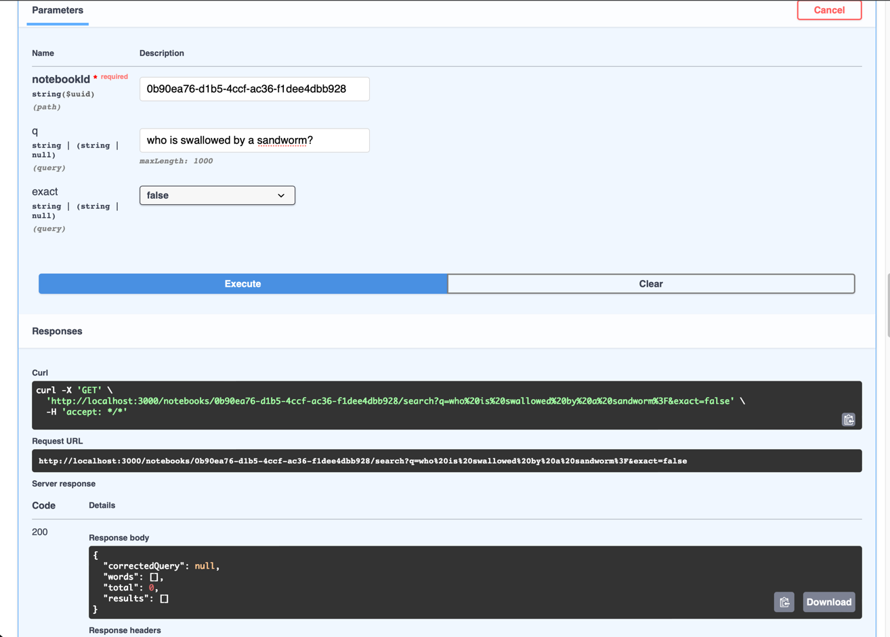
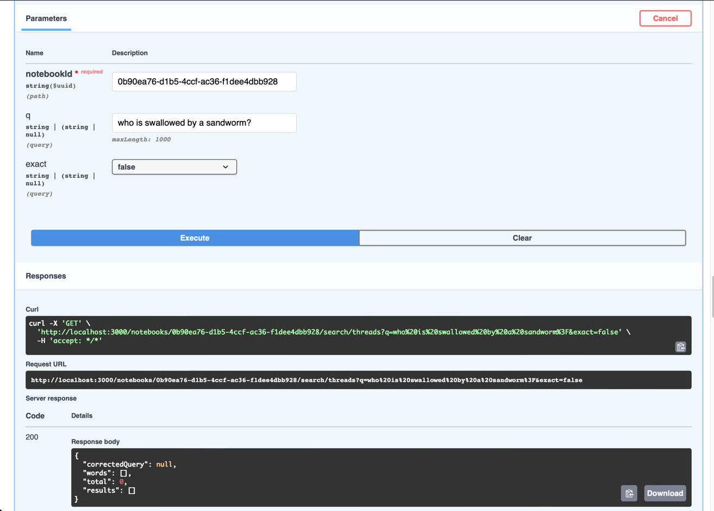
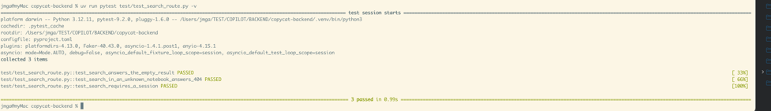

# T17 — Keyword search: stub both routes (search itself dropped)

| Mode | Effort | Priority | Depends on | Unblocks | Learning value |
| --- | --- | --- | --- | --- | --- |
| Stub | 0.1 day | P2 | T04 | T19 | — |

## Why it is dropped

The full task (1.5 days) is Postgres full-text search end to end: `websearch_to_tsquery`, stored
`tsvector` columns, `ts_headline`, trigram similarity for typo correction. It is good SQL learning
and almost no Python learning, and nothing you keep depends on it. Thread search (T18) is a repeat
of it and is dropped with it.

## What you need to know

### 1. Query parameters

A function parameter that is not in the path becomes a query parameter. `Annotated[str, Query()]`
adds validation and a description; a default makes it optional.

```python
from typing import Annotated
from fastapi import Query


async def search(
    q: Annotated[str, Query(max_length=1000)] = "", exact: str = "false"
) -> dict: ...
```

### 2. Returning a plain dict

A route may return a dict instead of a DTO. With `response_model` set, FastAPI validates it
against the DTO; without, it is serialised as is. The empty shape of both search responses is the
same four keys, so one constant serves both routes.

```python
EMPTY_SEARCH = {"correctedQuery": None, "words": [], "total": 0, "results": []}
```

### 3. The 404 check

Every route nested under a Notebook asks `NotebookRepository.notebook_exists` first, so an unknown
or deleted Notebook answers 404 and not an empty result.

## What to build

Three small steps: two stub routes, two files to delete, one test.

### Step 1. The two stub routes

**File:** `src/search/search_router.py`

Both routes check the Notebook, then answer the same empty shape:

```python
router = APIRouter(tags=["search"])

NotebookId = Annotated[uuid.UUID, Path(alias="notebookId")]
Notebooks = Annotated[NotebookRepository, Depends()]

EMPTY_SEARCH = {"correctedQuery": None, "words": [], "total": 0, "results": []}


@router.get("/notebooks/{notebookId}/search")
async def search_notebook(
    *, notebook_id: NotebookId, q: str = "", exact: str = "false", _: CurrentUser, notebooks: Notebooks
) -> dict:
    if not await notebooks.notebook_exists(notebook_id):
        raise HTTPException(404, "Notebook not found.")
    return EMPTY_SEARCH


@router.get("/notebooks/{notebookId}/search/threads")
async def search_chat_threads(...) -> dict:
    ...  # same parameters, same body
```

Make sure the router is included in `app/main.py` (see `routers.py`).

**DONE WHEN:** both routes print the empty result:

```sh
curl -b cookies.txt "localhost:3000/notebooks/<nb>/search?q=hello"
curl -b cookies.txt "localhost:3000/notebooks/<nb>/search/threads?q=hello"
```

```json
{"correctedQuery":null,"words":[],"total":0,"results":[]}
```





### Step 2. Delete the unused entities

**Delete** `src/search/citation_entity.py` and `src/search/keyword_entity.py` (see T02). Keep
`search_dto.py` only if something imports it.

**DONE WHEN:** the search prints nothing:

```sh
grep -rn "citation_entity\|keyword_entity" src
```


### Step 3. One test

**File:** `test/test_search_route.py`

1. Sign in and create a Notebook.
2. `GET .../search?q=x` answers 200 with `total == 0`.
3. An unknown Notebook id answers 404.

**DONE WHEN:** the test file is green:

```sh
uv run pytest test/test_search_route.py -q
```



## If you pick it up later

`GET /notebooks/{nb}/search?q=&exact=` is full-text search over the Chunks of each Document's
latest `ready` Version, with typo correction against the Notebook's word list (NOTEBOOKS
`docs/search.md`). It needs no OpenRouter key. The reference folder
`BACKEND/reference-backend/src/search/` can be copied as is; this is what it contains.

| Piece | File | What it does |
| --- | --- | --- |
| DTOs | `search_dto.py` | `TextSegment` (`text`, `match`), `SearchMatch` (`versionId`, `chunkId`, `charStart`, `charEnd`), `DocumentSearchResult` (`documentId`, `filename`, `title`, `headingPath`, `match`, `excerpt`) |
| Headlines | `keywords.py` | `TEXT_SEARCH_CONFIG = "simple_unaccent"`, the private-use delimiters for `ts_headline`, `segments(headline)`, `excerpt(headline, source)`, `names_a_word(db, query)` |
| Plain text | `plain_text.py` | `plain_text(markdown)` strips Markdown markers for the excerpt |
| Typo correction | `correction.py` | `correct(db, notebook_id, query)` over `notebook_words` with `%` and `similarity() >= 0.4`; `searched_words(query)` |
| Repository | `search_repository.py` | `search_chunks(notebook_id, query, typed)`: `SEARCH_CHUNKS_SQL` over `searchable_versions`, ordered "matched as typed first, then rank", `COUNT(*) OVER ()`, limit 20; one `ts_headline` query over the plain texts; ranges from `chunk_ranges` |

**Tests to bring with it.** Seed a `ready` Version with one chunk and a `chunk_ranges` row,
then check three things:

- `etretat` finds `Étretat` (accents are folded);
- `famus` is corrected to `famous`;
- with `exact=true`, it is not.

### References

- Node: `apps/backend/src/search/`; NOTEBOOKS `docs/search.md`.
